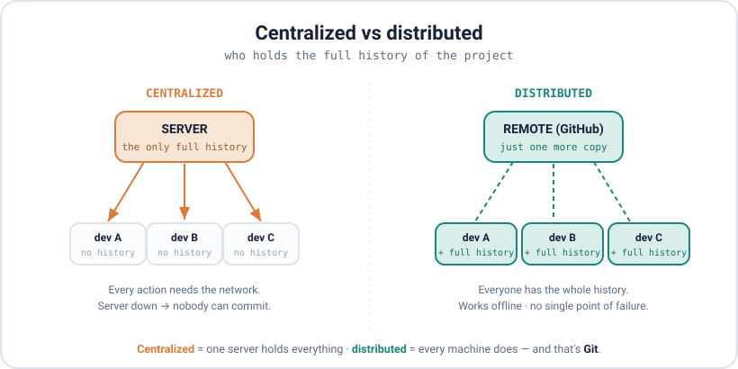

<div align="center">

# 01 · What is Git

</div>

> What Git is before I run a single command: a tool that saves the history of my project so I can go back to any point, see what changed, and work with other people without copies flying around. Everything else in these notes sits on top of this.

### 📌 What's in here

| # | Topic | In one line |
|:-:|---|---|
| 1 | [What it is](#1-what-it-is) | Snapshots of my project over time |
| 2 | [Life without it](#2-life-without-it) | The folder-copy mess |
| 3 | [Centralized vs distributed](#3-centralized-vs-distributed) | Who holds the history |
| 4 | [Why Git](#4-why-git) | Fast, offline, cheap branches |
| 5 | [Install it (Linux)](#5-install-it-linux) | One `apt` command |
| 6 | [Set up my identity](#6-set-up-my-identity) | Sign my commits + config levels |
| 7 | [Getting help](#7-getting-help) | `--help`, `-h`, `man` |
| ✔ | [Watch out](#-watch-out) · [Fix it](#-fix-it) · [Try it](#-try-it) · [What confused me](#-what-confused-me) | |

<p align="center"></p>

---

## 1. What it is

Git is a **version control system (VCS)** — a tool that saves **snapshots** of my project as I work. Each snapshot is a **commit**. I can jump back to any commit, compare two of them, or undo something I did last week.

It's **distributed**, which means the full history lives on my own machine, not on a server. So I can commit, read history, and branch with no internet at all.

> [!NOTE]
> **Git is not GitHub.** Git is the tool on my computer. GitHub is a website that stores a copy of my repo online so I can share it. **Git = the app**, **GitHub = the place I upload to**. I only need GitHub when I want to go online (that's Part 5).

## 2. Life without it

Before version control, saving versions means copying the folder:

```
project/
project-final/
project-final-v2/
project-FINAL-actually/
```

Three problems show up fast: I lose track of which one is current, I can't see what actually changed between two of them, and if someone else edits their own copy, **merging the two by hand is painful**. Git fixes all three — one folder, full history, and it does the merging for me.

## 3. Centralized vs distributed

There are two ways a VCS can be built, and the difference matters day to day.

<p align="center"></p>

- **Centralized** (SVN, TFS): the history lives on **one server**. Every action needs the network. If the server is down, nobody can commit or even look at history.
- **Distributed** (Git, Mercurial): **every person has the full history** on their machine. I work offline, and only talk to a server when I want to share.

🗣️ Centralized is one shared whiteboard everyone has to stand at. Distributed gives everyone their own copy of the whole book; you sync up when you feel like it.

## 4. Why Git

Why Git won over the others:

- **Fast** — most commands are local, so there's no network wait.
- **Works offline** — commit on a plane, sync later.
- **Cheap branches** — making a branch is instant (Part 4).
- **Free and open source** — which is why it's everywhere.

## 5. Install it (Linux)

I'm on Linux Mint, so it's `apt`:

```bash
sudo apt update
sudo apt install git
git --version          # check it worked
# git version 2.43.0   (any 2.x is fine)
```

## 6. Set up my identity

Git stamps every commit with a name and email, so I set those once per machine:

```bash
git config --global user.name "Haseeb Rehman"
git config --global user.email "me@example.com"   # same email as my GitHub
git config --global core.editor "nano"            # friendlier than the default (Vim)
git config --global core.autocrlf input           # line endings — see note
git config --list --show-origin                   # check it, and see which file each lives in
```

> [!NOTE]
> **On Linux, `core.autocrlf` is `input`, not `true`.** `true` is the Windows value. `input` fixes Windows-style line endings coming in and leaves my files alone going out.

**The three config levels.** Git reads settings from three places, and the most specific one wins:

| Level | Flag | Applies to |
|---|---|---|
| system | `--system` | every user on the machine |
| global | `--global` | all my repos |
| local | `--local` (default) | just the current repo — **overrides the others** |


So I keep my personal email global, and set a work email with `--local` inside a work repo when I need to.

## 7. Getting help

Three ways to read Git's own manual for any command:

```bash
git config --help     # full manual page (press q to quit)
man git-config        # same manual, the classic way
git config -h         # short one-screen summary of the options
```

Long flag (`--help`) → long manual. Short flag (`-h`) → short summary.

---

## ⚠️ Watch out

- `git config` without `--global` only changes the **current repo**. If my name is missing everywhere, I forgot `--global`.
- On Linux, `core.autocrlf` is `input`. Don't copy the Windows `true` value.
- Deleting the hidden `.git` folder deletes the **whole history** — the folder goes back to being a plain folder.
- "Distributed" means I already have the full history locally. I don't need the server to look at my own past.

## 🔧 Fix it

Set the wrong name or email? Fix it for all future commits in one line:

```bash
git config --global user.email "right@email.com"
```

(Commits already made keep the old email — fixing those is history rewriting, which is Part 6.)

## 🧪 Try it

> Install Git, set your name, email, editor and `core.autocrlf`, then prove every setting took — and see which file each one lives in.

<details>
<summary>Show the answer</summary>

```bash
sudo apt install git
git --version
git config --global user.name "Your Name"
git config --global user.email "you@example.com"
git config --global core.editor "nano"
git config --global core.autocrlf input
git config --list --show-origin
# every --global line shows  file:/home/you/.gitconfig
```

</details>

## 🤔 What confused me

> That **Git and GitHub are different things**. I thought I needed an online account to use Git at all. I don't — Git runs entirely on my machine, and GitHub is just one place I can push a copy to later. I can do everything in the first four parts of these notes with no account and no internet.

---

**One-line recap:** Git is a tool that saves snapshots of my project locally; it's distributed, so I hold the full history and work offline. Install with `apt`, set my identity once with `git config --global`, and remember Git ≠ GitHub.

---

[🏠 Index](../README.md) · [02 · Creating Snapshots ➡](../02-creating-snapshots/README.md)
