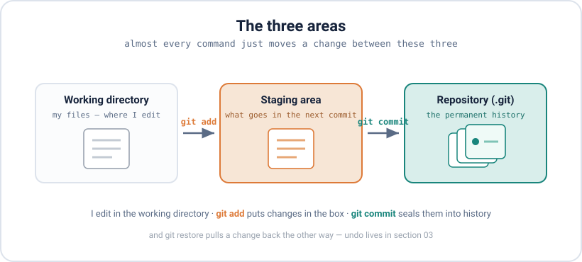
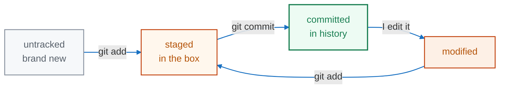

<div align="center">

# 02 · Creating Snapshots

**Part 2 — The Core Workflow** · ✅ Done

</div>

> The loop I run all day: turn a folder into a repo, move my changes through three areas, and save them as a commit. Once the three areas click, most of Git makes sense.

### 📌 What's in here

| # | Topic | In one line |
|:-:|---|---|
| 1 | [Start a repo](#1-start-a-repo--git-init) | `git init` and the `.git` folder |
| 2 | [The three areas](#2-the-three-areas) | Working dir → staging → repo |
| 3 | [Stage changes](#3-stage-changes--git-add--git-status) | `git add` and reading `git status` |
| 4 | [Save a snapshot](#4-save-a-snapshot--git-commit) | `git commit` and what a commit holds |
| 5 | [Good commits](#5-good-commits) | Small, with a clear message |
| 6 | [The `-am` shortcut](#6-the--am-shortcut) | Stage + commit in one (watch the trap) |
| ✔ | [Watch out](#-watch-out) · [Fix it](#-fix-it) · [Try it](#-try-it) · [What confused me](#-what-confused-me) | |

<p align="center"></p>

---

## 1. Start a repo — `git init`

I turn any folder into a repo by running one command inside it:

```bash
cd ~/myproject
git init
# Initialized empty Git repository in ~/myproject/.git/
```

That makes a hidden `.git` folder. **That folder is the repo** — every commit and all the history live inside it. My actual files just sit next to it:

```bash
ls -a          # the . prefix means hidden on Linux
# .  ..  .git  README.md  app.py
```

> [!NOTE]
> Delete `.git` and I delete the **whole history** — the folder becomes an ordinary folder again. I also only run `git init` **once** per project; a repo I cloned is already a repo.

## 2. The three areas

Almost every command just moves a change between three places. This is the one picture to keep in my head (it's the diagram up top):

- **Working directory** — my actual files, where I edit.
- **Staging area** — a holding area for the changes I want in my *next* commit.
- **Repository** (`.git`) — the permanent history.

`git add` moves a change from the working directory into staging. `git commit` saves everything staged into the repository.

🗣️ Like packing a box: my desk is the working directory (everything out, mid-work), the box is the staging area (I put in only what belongs in *this* shipment), and taping it shut and labelling it is the commit (now it's a sealed record).

The staging area is the part that's easy to overlook but worth getting: it lets me pick **exactly which changes go into a commit**, instead of saving everything at once.

## 3. Stage changes — `git add` & `git status`

`git status` is the command I run constantly — it tells me where everything stands:

```bash
git status
# Untracked files:
#   README.md
#   app.py
# nothing added to commit but untracked files present
```

A new file starts **untracked** — Git sees it but isn't saving it yet. I stage with `git add`:

```bash
git add README.md          # one file
git add app.py style.css   # a few, by name
git add .                  # everything changed here and below
```

The short status (`-s`) is quicker to read. Left column = staging, right column = the working directory:

```bash
git status -s
# A  README.md     <- staged
# ?? app.py        <- untracked
```

A file moves through these states, and `git status` always tells me which one it's in:



> [!NOTE]
> In `git status`, **red** = not staged yet, **green** = staged. Red isn't an error — it just means "not in the box yet."

## 4. Save a snapshot — `git commit`

`git commit` takes everything staged and seals it into history. `-m` gives the message inline:

```bash
git commit -m "Initial commit"
# [main (root-commit) 92a6119] Initial commit
#  2 files changed, 2 insertions(+)
git log --oneline
# 92a6119 Initial commit
```

That `92a6119` is the commit's **hash** — a unique fingerprint. Each commit stores four things: a **snapshot** of my files, a link to its **parent** commit (that's what chains history together), my **name and the time**, and my **message**. Change any of that and the hash changes — which is why history can't be quietly edited.

## 5. Good commits

Two habits that make history worth having:

- **One commit = one thing.** Don't bundle a bug fix, a rename and a new feature together. If I need to undo the bug fix later, I don't want to lose the feature with it.
- **Write the message in the present tense**, saying what the commit does: `Fix login redirect`, not `fixed stuff`. Short and specific.

## 6. The `-am` shortcut

For files Git **already tracks**, `-a` stages and commits them in one step:

```bash
git commit -am "Update homepage text"
```

> [!NOTE]
> `-a` only grabs **tracked** files. A brand-new file Git has never seen is **not** included — I have to `git add` it at least once first. This is the classic "why didn't my new file get committed?" surprise.

---

## ⚠️ Watch out

- `git add` does **not** save anything — only `git commit` does.
- **Staging is a snapshot, not a live link.** If I `git add` a file, then edit it again, then commit, the commit has the *first* version. The later edit is still waiting.
- `git commit -am` skips brand-new (untracked) files.
- Plain `git commit` with no `-m` opens an editor. If it's Vim: `Esc` then `:wq`. Easier to just use `-m`.

## 🔧 Fix it

Staged something I didn't mean to? Take it back out of the box — the file and my edits are untouched:

```bash
git restore --staged <file>
```

(The full undo tour is in [03 · Inspecting & Undoing](../03-inspecting-and-undoing/README.md).)

## 🧪 Try it

> In a fresh folder: make it a repo, create two files, stage only one, commit, then view the one-line history. Then hit the snapshot gotcha on purpose — stage a file, edit it again, commit, and check what actually got saved.

<details>
<summary>Show the answer</summary>

```bash
mkdir demo && cd demo && git init
echo "one" > a.txt
echo "two" > b.txt
git add a.txt            # stage only a.txt
git status -s            # A a.txt   /   ?? b.txt
git add .
git commit -m "Add a and b"
git log --oneline

# the gotcha:
echo "first" > c.txt
git add c.txt            # snapshot taken now
echo "second" >> c.txt   # edit AFTER adding
git commit -m "Add c"
git show HEAD:c.txt      # only "first" made it into the commit
```

</details>

## 🤔 What confused me

> Why `add` and `commit` are two separate steps. `add` only moves a change into the **staging area** — the box — it doesn't save it. `commit` is the real save that seals whatever is in the box into history. They're separate so I can choose exactly what goes into each commit instead of saving everything at once.

---

**One-line recap:** `git init` makes the repo; then I loop — edit → `git status` → `git add` → `git commit -m` → `git log`. A commit is a snapshot, staging lets me pick what goes in it, and it's snapshotted at `add` time, not kept as a live link.

---

[⬅ 01 · What is Git](../01-what-is-git/README.md) · [🏠 Index](../README.md) · [03 · Inspecting & Undoing ➡](../03-inspecting-and-undoing/README.md)
