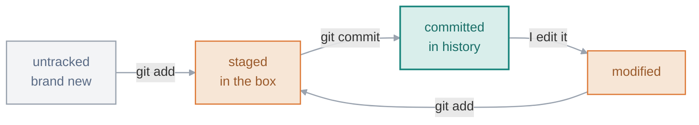

# 02 · Creating Snapshots

> The loop I run all day: turn a folder into a repo, move changes through three areas, and seal them into a commit. Once the three areas clicked for me, most of the rest of Git stopped feeling random.

**On this page:** [git init](#starting-a-repo) · [the three areas](#the-three-areas) · [staging](#staging-changes) · [committing](#saving-a-snapshot) · [good commits](#what-makes-a-good-commit) · [the -am shortcut](#the--am-shortcut)

---

## Starting a repo

I turn any folder into a repo with one command inside it:

```bash
cd ~/myproject
git init
# Initialized empty Git repository in ~/myproject/.git/
```

That makes a hidden `.git` folder, and **that folder is the repo** — every commit and all the history live inside it. My actual files just sit next to it:

```bash
ls -a          # the . prefix means hidden on Linux
# .  ..  .git  README.md  app.py
```

Two things I had to burn in early: deleting `.git` deletes the **whole history** (the folder goes back to being an ordinary folder), and I only run `git init` **once** per project — a repo I cloned is already a repo.

## The three areas

Almost every Git command just moves a change between three places, and this is the picture I keep in my head for all of it:


`git add` moves a change from the working directory into staging; `git commit` saves everything staged into the repository. The way it finally made sense to me is packing a box: my desk is the working directory (everything out, mid-work), the box is staging (I put in only what belongs in *this* shipment), and taping it shut and labelling it is the commit. The staging area is the part that's easy to overlook, but it's the whole reason I can pick exactly which changes go into a commit instead of saving everything at once.

## Staging changes

`git status` is the command I run constantly — it tells me where everything stands:

```bash
git status
# Untracked files:
#   README.md
#   app.py
# nothing added to commit but untracked files present
```

A new file starts **untracked** — Git sees it but isn't saving it yet. I stage with `git add`:

```bash
git add README.md          # one file
git add app.py style.css   # a few, by name
git add .                  # everything changed here and below
```

The short status (`-s`) is quicker to read — left column is staging, right column is the working directory:

```bash
git status -s
# A  README.md     <- staged
# ?? app.py        <- untracked
```

A file moves through a handful of states, and `git status` always tells me which one it's in:



In `git status`, red means not staged yet and green means staged. Red isn't an error — it just means "not in the box yet."

## Saving a snapshot

`git commit` takes everything staged and seals it into history. `-m` gives the message inline:

```bash
git commit -m "Initial commit"
# [main (root-commit) 92a6119] Initial commit
#  2 files changed, 2 insertions(+)
git log --oneline
# 92a6119 Initial commit
```

That `92a6119` is the commit's **hash**, a unique fingerprint. Each commit stores four things: a snapshot of my files, a link to its **parent** commit (that's what chains history together), my name and the time, and my message. Change any of it and the hash changes — which is why history can't be quietly edited. (Plain `git commit` with no `-m` drops me into an editor; if it's Vim, `Esc` then `:wq` escapes — I just use `-m` to avoid the whole thing.)

## What makes a good commit

Two habits that make the history actually worth having:

- **One commit = one thing.** Don't bundle a bug fix, a rename and a new feature together. If I need to undo the bug fix later, I don't want the feature going with it.
- **Message in the present tense, saying what the commit does:** `Fix login redirect`, not `fixed stuff`. Short and specific.

## The `-am` shortcut

For files Git **already tracks**, `-a` stages and commits in one step:

```bash
git commit -am "Update homepage text"
```

The catch that got me: `-a` only grabs **tracked** files. A brand-new file Git has never seen is not included — I have to `git add` it at least once first. That's the classic "why didn't my new file get committed?" moment, and I've hit it more than once. And if I ever stage something I didn't mean to, `git restore --staged <file>` takes it back out of the box without touching the file or my edits (the full undo tour is next, in [03](../03-inspecting-and-undoing/README.md)).

---

**What tripped me up:** why `add` and `commit` are two separate steps at all — it felt like busywork. It clicked once I stopped thinking of `add` as saving. `add` only moves a change into the box; `commit` is the actual save that seals the box into history. The subtle part is that `add` takes the snapshot *then and there* — if I add a file, edit it again, then commit, the commit holds the version from when I added it, not my latest edit. That one cost me a confusing ten minutes before I spotted it.

---

[⬅ 01 · What is Git](../01-what-is-git/README.md) · [🏠 Index](../README.md) · [03 · Inspecting & Undoing ➡](../03-inspecting-and-undoing/README.md)
