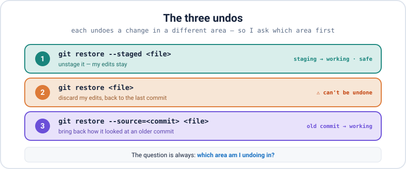
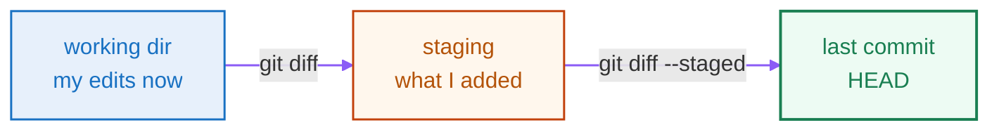

<div align="center">

# 03 · Inspecting & Undoing

**Part 2 — The Core Workflow** · ✅ Done

</div>

> How I see exactly what changed, and how I undo at any layer without panicking. The trick to undoing in Git is one question: **which area am I undoing in?**

### 📌 What's in here

| # | Topic | In one line |
|:-:|---|---|
| 1 | [See what changed](#1-see-what-changed--git-diff) | `git diff` vs `git diff --staged` |
| 2 | [Remove & rename](#2-remove--rename) | `rm`, `rm --cached` + `.gitignore`, `mv` |
| 3 | [The three undos](#3-the-three-undos) | Unstage · discard · restore an old version |
| ✔ | [Watch out](#-watch-out) · [Fix it](#-fix-it) · [Try it](#-try-it) · [What confused me](#-what-confused-me) | |

<p align="center"></p>

---

## 1. See what changed — `git diff`

`git diff` shows my changes line by line. The thing to get right is *which two things* it compares — and there are two:



- `git diff` → what I've changed but **not staged yet** (working dir vs staging).
- `git diff --staged` → what I've **staged**, ready to commit (staging vs last commit).

```bash
git diff
# @@ -1,3 +1,3 @@
#  function greet() {
# -  console.log("hi")
# +  console.log("hello")
#  }
```

A `-` line (red) was removed, a `+` line (green) was added. The `@@ -1,3 +1,3 @@` header says which lines the chunk covers. Once I stage the file, `git diff` shows nothing and the change moves to `git diff --staged` — proof of which area it's in.

## 2. Remove & rename

I could delete or rename files in my file manager, but then I'd have to tell Git separately. Git's own commands do both at once:

```bash
git rm old.txt            # delete the file AND stage the deletion
git mv old.txt new.txt    # rename AND stage it
git rm --cached file.txt  # stop tracking it, but KEEP it on disk
```

```bash
git rm --cached secrets.env
# rm 'secrets.env'
ls secrets.env            # still there — only Git stopped tracking it
```

> [!NOTE]
> **`--cached` is the one that saves me.** If I accidentally committed `secrets.env` or a huge `node_modules/`, `git rm --cached` makes Git forget it **without deleting** the real file. Then I add it to `.gitignore` so Git won't offer to track it again. (`.gitignore` only affects files Git isn't already tracking — that's why the untrack step comes first.)

## 3. The three undos

This is where people mix things up. Each undo touches a **different area** — the decoder up top lays them out. Keep asking: *which area am I undoing in?*

**Unstage** — I added something I didn't mean to stage. This takes it out of staging; my file and edits are untouched.

```bash
git restore --staged file.txt      # modern
git reset HEAD file.txt            # older, same thing
```

**Discard** — throw away my edits and go back to the last commit. **This one is destructive** — the edits are gone, because they were never saved anywhere.

```bash
git restore file.txt               # modern
git checkout -- file.txt           # older, same thing
```

**Restore an old version** — pull one file back to how it looked at an earlier commit, without touching anything else.

```bash
git restore --source=HEAD~2 file.txt
git checkout <commit> -- file.txt  # older, same thing
```

> [!NOTE]
> `restore --staged` and `restore <file>` look almost identical but do opposite things. With `--staged` I keep my work; without it, I **lose** my uncommitted edits. The `--staged` flag is the whole difference.

---

## ⚠️ Watch out

- Plain `git diff` shows only **unstaged** changes. Once I `git add`, the change moves to `git diff --staged`.
- `git restore <file>` (discard) is the **one undo I can't undo** — the edits were never committed, so nothing can bring them back. Be sure first.
- `git rm` deletes the file from disk; `git rm --cached` keeps it.
- `.gitignore` won't ignore a file Git is **already tracking** — untrack it with `git rm --cached` first.

## 🔧 Fix it

Committed a secret by mistake?

```bash
git rm --cached secrets.env
echo "secrets.env" >> .gitignore
git commit -m "Stop tracking secrets"
```

(The secret is still in the old commit's history — in the real world I'd also rotate the key. Fully removing it from history is Part 6.)

## 🧪 Try it

> Change a tracked file and view the diff. Stage it, and confirm the change moved from `git diff` to `git diff --staged`. Then practice all three undos: stage a change and unstage it, make a mess and discard it, and pull one file back from an earlier commit.

<details>
<summary>Show the answer</summary>

```bash
echo "// a change" >> app.js
git diff                        # shows the change (unstaged)
git add app.js
git diff                        # now empty
git diff --staged               # shows it here

git restore --staged app.js     # unstage (edit kept)
git restore app.js              # discard the edit (gone)
git restore --source=HEAD~1 app.js   # bring back an older version
```

</details>

## 🤔 What confused me

> That `git restore --staged file` and `git restore file` are different commands. They read almost the same, but `--staged` just takes the change **out of the box** and keeps my edits, while the plain one **overwrites my file** with the last committed version and throws my edits away. One is safe, one isn't — and the only difference on screen is one flag.

---

**One-line recap:** `git diff` = unstaged changes, `git diff --staged` = staged changes. `git rm --cached` untracks without deleting. And the three undos each act on a different area: `restore --staged` unstages, `restore <file>` discards (careful), `restore --source` brings back an old version.

---

[⬅ 02 · Creating Snapshots](../02-creating-snapshots/README.md) · [🏠 Index](../README.md) · [04 · Reading & Filtering History ➡](../04-reading-and-filtering-history/README.md)
