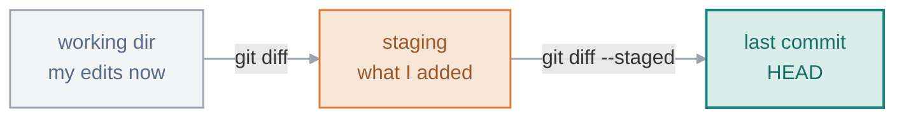

# 03 · Inspecting & Undoing

> How I see exactly what changed, and how I undo at any layer without panicking. The whole trick to undoing in Git turned out to be one question: **which area am I undoing in?**

**On this page:** [seeing changes](#seeing-what-changed) · [remove & rename](#removing-and-renaming) · [the three undos](#the-three-undos)

---

## Seeing what changed

`git diff` shows my changes line by line. The thing I had to get right is *which two things* it compares, because there are two different diffs:



`git diff` on its own shows what I've changed but **not staged yet** (working dir vs staging). `git diff --staged` shows what I've **staged**, ready to commit (staging vs last commit).

```bash
git diff
# @@ -1,3 +1,3 @@
#  function greet() {
# -  console.log("hi")
# +  console.log("hello")
#  }
```

A `-` line (red) was removed, a `+` line (green) was added, and the `@@ -1,3 +1,3 @@` header says which lines the chunk covers. The useful tell: once I stage the file, plain `git diff` shows nothing and the change moves to `git diff --staged` — that's how I know which area a change is sitting in.

## Removing and renaming

I could delete or rename files in my file manager, but then I'd have to tell Git separately. Git's own commands do both at once:

```bash
git rm old.txt            # delete the file AND stage the deletion
git mv old.txt new.txt    # rename AND stage it
git rm --cached file.txt  # stop tracking it, but KEEP it on disk
```

`--cached` is the one that has saved me. If I accidentally commit `secrets.env` or a huge `node_modules/`, it makes Git forget the file **without deleting** the real thing:

```bash
git rm --cached secrets.env
# rm 'secrets.env'
ls secrets.env            # still there — only Git stopped tracking it
```

Then I add it to `.gitignore` so Git won't offer to track it again:

```bash
git rm --cached secrets.env
echo "secrets.env" >> .gitignore
git commit -m "Stop tracking secrets"
```

Order matters here, and it tripped me up once: `.gitignore` only affects files Git **isn't already tracking**, so the untrack step has to come first. (And the secret still lives in the old commit's history — in the real world I'd rotate the key too. Scrubbing it from history entirely is Part 6.)

## The three undos

This is where I used to mix things up, until I drew it out. Each undo touches a **different area**, so the question is always: *which area am I undoing in?*


**Unstage** — I added something I didn't mean to. This takes it out of staging; my file and edits are untouched:

```bash
git restore --staged file.txt      # modern
git reset HEAD file.txt            # older, same thing
```

**Discard** — throw away my edits and go back to the last commit. **This one is destructive** — the edits are gone, because they were never saved anywhere:

```bash
git restore file.txt               # modern
git checkout -- file.txt           # older, same thing
```

**Restore an old version** — pull one file back to how it looked at an earlier commit, without touching anything else:

```bash
git restore --source=HEAD~2 file.txt
git checkout <commit> -- file.txt  # older, same thing
```

Of the three, `git restore <file>` (discard) is the one undo I genuinely can't undo — the edits were never committed, so nothing brings them back. I double-check before running it.

---

**What tripped me up:** that `git restore --staged file` and `git restore file` are different commands that read almost the same. With `--staged` I'm just taking the change **out of the box** and keeping my edits; without it I'm **overwriting the file** with the last committed version and throwing my edits away. One is safe, one isn't, and the only difference on screen is a single flag — I've learned to pause on that one.

---

[⬅ 02 · Creating Snapshots](../02-creating-snapshots/README.md) · [🏠 Index](../README.md) · [04 · Reading & Filtering History ➡](../04-reading-and-filtering-history/README.md)
