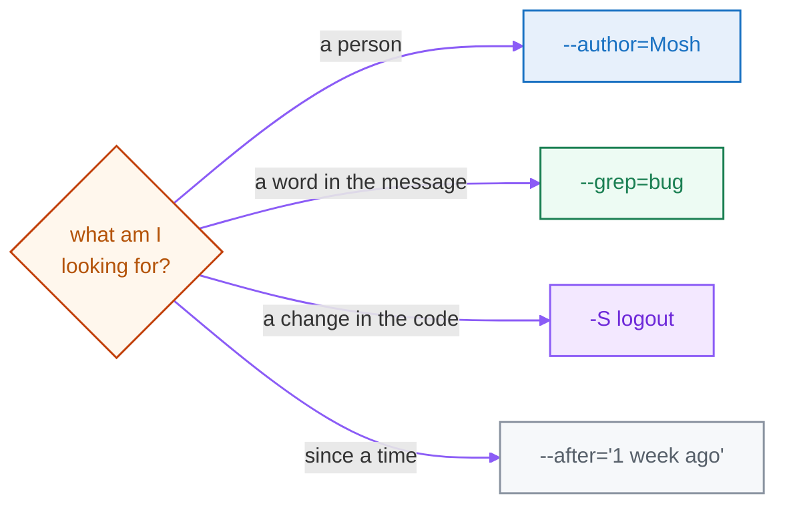

<div align="center">

# 04 · Reading & Filtering History

**Part 3 — Browsing History** · ✅ Done

</div>

> On a real project the log has thousands of commits. The skill isn't reading it — it's filtering it down to the one I want. These flags turn `git log` into a search engine.

### 📌 What's in here

| # | Topic | In one line |
|:-:|---|---|
| 1 | [Shaping the log](#1-shaping-the-log) | `--oneline`, `--stat`, `-p` |
| 2 | [Filtering the history](#2-filtering-the-history) | By author, time, message, or code |
| 3 | [Ranges & one file](#3-ranges--one-file) | `a..b` and `-- <file>` |
| 4 | [Aliases](#4-aliases) | Save a long command as one word |
| ✔ | [Watch out](#-watch-out) · [Fix it](#-fix-it) · [Try it](#-try-it) · [What confused me](#-what-confused-me) | |

<p align="center"></p>

---

## 1. Shaping the log

Raw `git log` is wordy — one big block per commit. These flags reshape it:

```bash
git log --oneline      # one line per commit
git log --stat         # + which files changed and how many lines
git log -p             # + the full diff of each commit
```

```bash
git log --oneline
# f5f67b1 Add footer
# ce4064b Fix logout bug
# dc7e218 Add navigation bar
# 8037b3e Add login function
```

`-p` and `--patch` are the same flag. `--oneline` is the one I use most.

## 2. Filtering the history

Each filter answers a real "find me the commit that…" question. They **stack** — I can combine as many as I like.

| I want… | Flag |
|---|---|
| the last N commits | `git log -3` |
| commits by a person | `git log --author="Mosh"` |
| since a time | `git log --after="1 week ago"` |
| a word in the **message** | `git log --grep="bug"` |
| a change in the **code** | `git log -S"logout"` |
| commits touching a file | `git log -- auth.js` |



The two that get mixed up are `--grep` and `-S`:

```bash
git log --grep="Fix" --oneline    # searches the MESSAGE I wrote
# ce4064b Fix logout bug

git log -S"logout" --oneline      # searches the CODE that changed
# ce4064b Fix logout bug
```

> [!NOTE]
> `--grep` reads the **message**. `-S` (the "pickaxe") reads the **actual code** — "find every commit that added or removed the text `logout`," even if no message ever mentioned it. When I'm hunting *when a line of code appeared or vanished*, `-S` is the tool nothing else replaces.

## 3. Ranges & one file

```bash
git log --oneline -- auth.js      # only commits that touched this file
# ce4064b Fix logout bug
# 8037b3e Add login function

git log abc123..def456            # commits between two points
git log --graph --oneline --all   # draw the branch structure (great in Part 4)
```

> [!NOTE]
> The `--` before a filename means "everything after this is a **path**, not a flag or a branch." It avoids confusion when a file and a branch share a name. The `-- file` part goes last.

## 4. Aliases

Typing `git log --graph --oneline --all` ten times a day gets old. I save it as a shortcut in my global config and call it with one word:

```bash
git config --global alias.lg "log --graph --oneline --all"
git lg                 # now runs the whole thing
git config --global alias.last "log -1 --oneline"
```

An alias is just a line in `~/.gitconfig` — the value is the command minus the leading `git`.

---

## ⚠️ Watch out

- `--grep` searches the **message**; `-S` searches the **code**. They're not the same.
- Put the `-- file` part **last**, after the flags.
- `--after` understands plain phrases like `"1 week ago"` and `"2026-01-01"`.
- Filters stack — `git log --author="Mosh" --after="1 week ago" -- auth.js` is fine.

## 🔧 Fix it

Running the same long `git log` over and over? Turn it into an alias once:

```bash
git config --global alias.lg "log --graph --oneline --all"
```

## 🧪 Try it

> Build a few commits (some by a made-up author, some touching different files). Then find: every commit whose message says "Fix", every commit that changed the text `login` in the code, and every commit that touched `auth.js`.

<details>
<summary>Show the answer</summary>

```bash
git log --grep="Fix" --oneline       # by message
git log -S"login" --oneline          # by code (pickaxe)
git log --oneline -- auth.js         # by file
git log --author="Mosh" --oneline    # by person
```

</details>

## 🤔 What confused me

> The difference between `--grep` and `-S`. I kept using `--grep` to find where a function was added and it found nothing — because `--grep` only reads the commit *message*, and the message didn't mention the function. `-S` reads the actual code change, so that's the one that finds "when did this line appear."

---

**One-line recap:** shape the log with `--oneline`/`--stat`/`-p`, then filter: `--author` by person, `--after` by time, `--grep` by message, `-S` by code, `-- <file>` by file. Stack them, and save the long ones as aliases.

---

[⬅ 03 · Inspecting & Undoing](../03-inspecting-and-undoing/README.md) · [🏠 Index](../README.md) · [05 · Investigating History ➡](../05-investigating-history/README.md)
