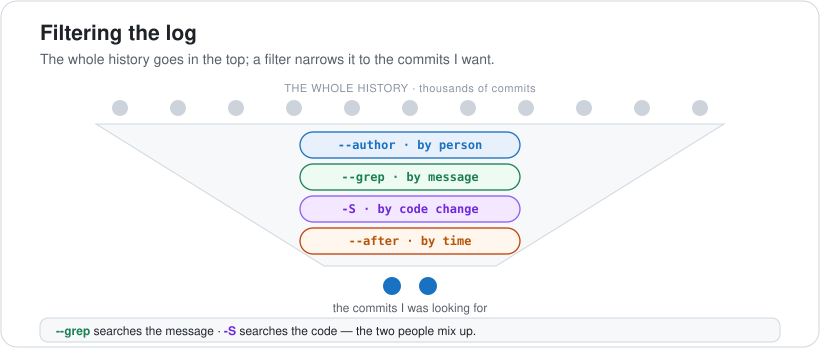

# 04 · Reading & Filtering History

> On a real project the log has thousands of commits, so the skill isn't reading it — it's filtering down to the one I want. These flags turn `git log` into a search engine, and this is the page I come back to most often.

**On this page:** [shaping the log](#shaping-the-log) · [filtering](#filtering-the-history) · [ranges & one file](#ranges-and-one-file) · [aliases](#aliases)

---

## Shaping the log

Raw `git log` is wordy — one big block per commit. These flags reshape it:

```bash
git log --oneline      # one line per commit
git log --stat         # + which files changed and how many lines
git log -p             # + the full diff of each commit
```

```bash
git log --oneline
# f5f67b1 Add footer
# ce4064b Fix logout bug
# dc7e218 Add navigation bar
# 8037b3e Add login function
```

`-p` and `--patch` are the same flag, and `--oneline` is the one I reach for most.

## Filtering the history

Each filter answers a real "find me the commit that…" question, and they **stack** — I can combine as many as I like.



| I want… | Flag |
|---|---|
| the last N commits | `git log -3` |
| commits by a person | `git log --author="Mosh"` |
| since a time | `git log --after="1 week ago"` |
| a word in the **message** | `git log --grep="bug"` |
| a change in the **code** | `git log -S"logout"` |
| commits touching a file | `git log -- auth.js` |

The two that get mixed up are `--grep` and `-S`:

```bash
git log --grep="Fix" --oneline    # searches the MESSAGE I wrote
# ce4064b Fix logout bug

git log -S"logout" --oneline      # searches the CODE that changed
# ce4064b Fix logout bug
```

`--grep` reads the **message**; `-S` (the "pickaxe") reads the **actual code** — "find every commit that added or removed the text `logout`," even if no message ever mentioned it. When I'm hunting *when a line of code appeared or vanished*, `-S` is the tool nothing else replaces.

## Ranges and one file

```bash
git log --oneline -- auth.js      # only commits that touched this file
# ce4064b Fix logout bug
# 8037b3e Add login function

git log abc123..def456            # commits between two points
git log --graph --oneline --all   # draw the branch structure (great in Part 4)
```

The `--` before a filename means "everything after this is a **path**, not a flag or a branch" — it avoids confusion when a file and a branch share a name, and the `-- file` part always goes last. Filters stack freely, so `git log --author="Mosh" --after="1 week ago" -- auth.js` is perfectly fine, and `--after` understands plain phrases like `"1 week ago"` or `"2026-01-01"`.

## Aliases

Typing `git log --graph --oneline --all` ten times a day gets old, so I save it as a shortcut in my global config and call it with one word:

```bash
git config --global alias.lg "log --graph --oneline --all"
git lg                 # now runs the whole thing
git config --global alias.last "log -1 --oneline"
```

An alias is just a line in `~/.gitconfig` — the value is the command minus the leading `git`.

---

**What tripped me up:** the difference between `--grep` and `-S`. I kept using `--grep` to find where a function was added and it found nothing — because `--grep` only reads the commit *message*, and my messages never mentioned the function by name. `-S` reads the actual code change, so that's the one that answers "when did this line appear (or disappear)." Once that clicked, the pickaxe became my favourite history tool.

---

[⬅ 03 · Inspecting & Undoing](../03-inspecting-and-undoing/README.md) · [🏠 Index](../README.md) · [05 · Investigating History ➡](../05-investigating-history/README.md)
