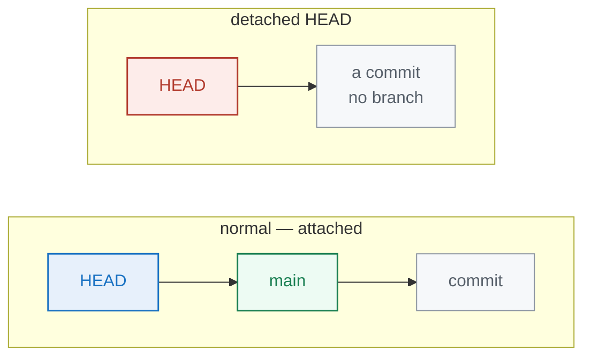

<div align="center">

# 05 · Investigating History

**Part 3 — Browsing History** · ✅ Done

</div>

> The detective tools: point at any commit, travel back safely, hunt down the commit that introduced a bug, find who wrote a line, bring back a deleted file, and tag releases.

### 📌 What's in here

| # | Topic | In one line |
|:-:|---|---|
| 1 | [Pointing at commits](#1-pointing-at-commits) | `HEAD~n`, a file at a commit, diff across commits |
| 2 | [Time travel & detached HEAD](#2-time-travel--detached-head) | `git checkout <commit>` safely |
| 3 | [Find a bug with bisect](#3-find-a-bug-with-bisect) | Binary-search the history |
| 4 | [Blame, shortlog & recovery](#4-blame-shortlog--recovering-a-deleted-file) | Who wrote it; bring back a deleted file |
| 5 | [Tagging](#5-tagging) | Mark releases |
| ✔ | [Watch out](#-watch-out) · [Fix it](#-fix-it) · [Try it](#-try-it) · [What confused me](#-what-confused-me) | |

<p align="center"></p>

---

## 1. Pointing at commits

`HEAD` is a pointer to where I am now — normally the latest commit. `~n` walks **backward** n steps: `HEAD~1` is the one before, `HEAD~2` two before.

I can read a file *as it was* at any commit, without checking anything out, using the `<commit>:<path>` syntax:

```bash
git show HEAD~3:auth.js
# function login(){}
```

And I can diff any two commits against each other:

```bash
git diff HEAD~2 HEAD               # everything that changed over the last 2 commits
git diff HEAD~2 HEAD -- auth.js    # ...just one file
```

> [!NOTE]
> Order matters: `git diff A B` reads "what changed going **from** A **to** B." Put the older commit first to read changes forward in time.

## 2. Time travel & detached HEAD

`git checkout <commit>` makes my whole working directory look like that moment. But it comes with a famous warning: **detached HEAD**.

Normally HEAD points at a *branch* (like `main`), and the branch points at the latest commit. Check out a raw commit and HEAD points **directly** at that commit, attached to no branch:



Commits I make while detached belong to no branch — and can be **lost** when I leave. To look around safely: don't commit, and get back with `git switch main`. If I *did* make commits there and want to keep them, I make a branch first: `git switch -c my-branch`.

## 3. Find a bug with bisect

A bug appeared somewhere in the last 100 commits. Testing them one by one is 100 tests. **bisect finds it in about 7** — by binary search (the diagram up top). I give Git one known-good and one known-bad commit; it jumps to the middle and asks me to test. Each answer halves what's left.

```bash
git bisect start
git bisect bad                 # the current commit is broken
git bisect good <old-hash>     # this old one worked
# Bisecting: 3 revisions left to test (roughly 2 steps)
# Git checks out the middle commit. I test it, then:
git bisect good                # or: git bisect bad
# ...repeat until Git names the first bad commit, then ALWAYS:
git bisect reset               # leave bisect mode, back to normal
```

> [!NOTE]
> The commands are easy; the thing I forget is `git bisect reset` at the end to leave the special bisect mode and return to my branch.

## 4. Blame, shortlog & recovering a deleted file

**`git blame`** shows who wrote each line, and when:

```bash
git blame auth.js
# ^8037b3e (Mosh 2026-11-05 1) function login(){}
# ce4064b6 (Mosh 2026-11-05 2) function logout(){}
```

**`git shortlog`** summarises contributors — `-n` by count, `-s` totals only, `-e` with emails:

```bash
git shortlog -n -s
#     42  Mosh
#     17  Haseeb
```

**Bring back a deleted file** in two steps: find the commit that deleted it, then restore it from that commit's **parent** (the last commit where it still existed):

```bash
git log --oneline -- logo.svg          # find the delete commit, e.g. e5f6a7b
git checkout e5f6a7b~1 -- logo.svg     # restore from its PARENT
```

> [!NOTE]
> The `~1` is the whole trick. At the delete commit the file is *already gone*; the version I want is in the commit just **before** it — the parent, `~1`. Forget the `~1` and Git can't find the file.

## 5. Tagging

Tags are permanent bookmarks on a commit — almost always releases like `v1.0`. Two kinds:

```bash
git tag v1.0                     # lightweight — just a name on a commit
git tag -a v1.0 -m "First release"   # annotated — stores author, date, message
git tag v1.0 5e3a1f9             # tag an older commit, not just HEAD
git tag                          # list tags
git tag -d v1.0                  # delete a tag
```

> [!NOTE]
> A **lightweight** tag is a sticky note with a name. An **annotated** tag (`-a`) is a full object with who/when/why. For real releases, use annotated — the metadata matters later.

---

## ⚠️ Watch out

- Committing in **detached HEAD** makes commits that belong to no branch — they can be lost. Make a branch first if you want to keep them.
- Restore a deleted file from the delete commit's **parent** (`~1`), not the delete commit itself.
- A lightweight tag has no author/date/message. Use `-a` for releases.
- Don't forget `git bisect reset` when the hunt is over.

## 🔧 Fix it

Made commits in detached HEAD and realised you need them? Before switching away, pin them to a branch:

```bash
git switch -c keep-these
```

## 🧪 Try it

> Plant a bug a few commits back, then use `git bisect` to find the first bad commit. Then `git blame` a file to see who wrote a line, delete a file and bring it back from its parent commit, and tag the current commit as `v1.0`.

<details>
<summary>Show the answer</summary>

```bash
# bisect
git bisect start
git bisect bad
git bisect good <known-good-hash>
# test each checkout, answer good/bad, until it names the culprit
git bisect reset

# blame + recover + tag
git blame app.js
git log --oneline -- gone.txt        # find the delete commit
git checkout <delete-hash>~1 -- gone.txt
git tag -a v1.0 -m "First release"
```

</details>

## 🤔 What confused me

> Why recovering a deleted file uses `~1`. I kept trying `git checkout <delete-commit> -- file` and it failed — because in the commit that *deleted* the file, the file doesn't exist. The last version is in the commit right before it, so I have to go to the parent with `~1`.

---

**One-line recap:** `HEAD~n` and `<commit>:<path>` point into the past; `checkout` time-travels (mind detached HEAD); `bisect` binary-searches for a bad commit; `blame`/`shortlog` show who did what; recover a deleted file from its parent (`~1`); and tag releases with `-a`.

---

[⬅ 04 · Reading & Filtering History](../04-reading-and-filtering-history/README.md) · [🏠 Index](../README.md) · [06 · Branches ➡](../06-branches/README.md)
