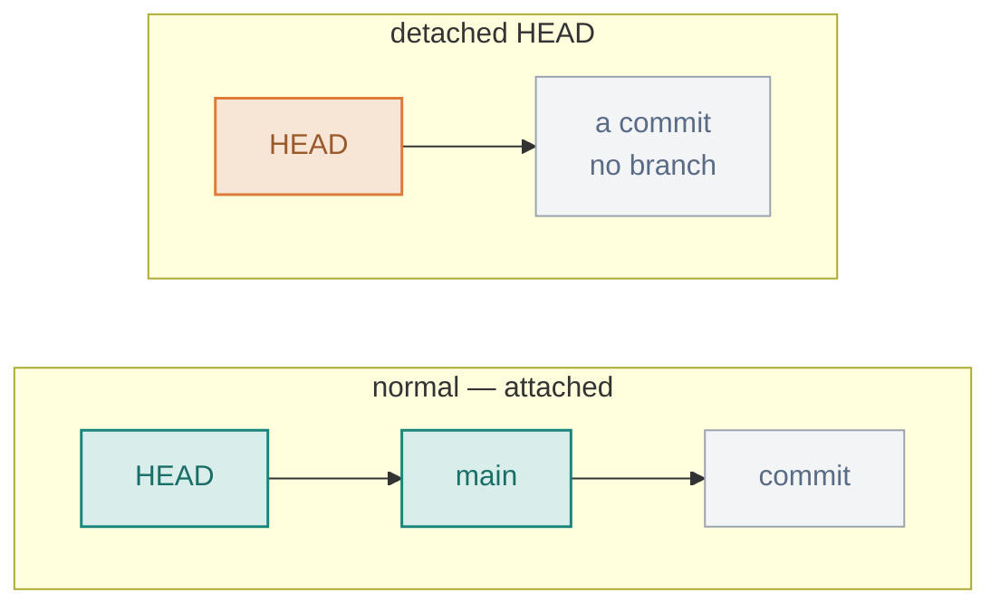

# 05 · Investigating History

> The detective tools: point at any commit, travel back safely, hunt down the commit that introduced a bug, find who wrote a line, bring back a deleted file, and tag releases.

**On this page:** [pointing at commits](#pointing-at-commits) · [time travel & detached HEAD](#time-travel-and-detached-head) · [bisect](#finding-a-bug-with-bisect) · [blame & recovery](#blame-shortlog-and-recovering-a-deleted-file) · [tagging](#tagging)

---

## Pointing at commits

`HEAD` is a pointer to where I am now — normally the latest commit. `~n` walks **backward** n steps: `HEAD~1` is the one before, `HEAD~2` two before.

I can read a file *as it was* at any commit, without checking anything out, using the `<commit>:<path>` syntax:

```bash
git show HEAD~3:auth.js
# function login(){}
```

And I can diff any two commits against each other:

```bash
git diff HEAD~2 HEAD               # everything that changed over the last 2 commits
git diff HEAD~2 HEAD -- auth.js    # ...just one file
```

Order matters: `git diff A B` reads "what changed going **from** A **to** B," so I put the older commit first to read changes forward in time.

## Time travel and detached HEAD

`git checkout <commit>` makes my whole working directory look like that moment — but it comes with a famous warning: **detached HEAD**.

Normally HEAD points at a *branch* (like `main`), and the branch points at the latest commit. Check out a raw commit and HEAD points **directly** at that commit, attached to no branch:



Commits I make while detached belong to no branch — and can be **lost** when I leave. To look around safely I just don't commit, and get back with `git switch main`. If I *did* make commits there and want to keep them, I pin them to a branch before switching away: `git switch -c keep-these`.

## Finding a bug with bisect

A bug appeared somewhere in the last 100 commits. Testing them one by one is 100 tests; **bisect finds it in about 7**, by binary search. I give Git one known-good and one known-bad commit, it jumps to the middle and asks me to test, and each answer halves what's left.


```bash
git bisect start
git bisect bad                 # the current commit is broken
git bisect good <old-hash>     # this old one worked
# Bisecting: 3 revisions left to test (roughly 2 steps)
# Git checks out the middle commit. I test it, then:
git bisect good                # or: git bisect bad
# ...repeat until Git names the first bad commit, then ALWAYS:
git bisect reset               # leave bisect mode, back to normal
```

The commands are easy; the thing I forget is `git bisect reset` at the end — without it I'm left parked on some middle commit in bisect mode instead of back on my branch.

## Blame, shortlog and recovering a deleted file

`git blame` shows who wrote each line, and when:

```bash
git blame auth.js
# ^8037b3e (Mosh 2026-11-05 1) function login(){}
# ce4064b6 (Mosh 2026-11-05 2) function logout(){}
```

`git shortlog` summarises contributors — `-n` by count, `-s` totals only, `-e` with emails:

```bash
git shortlog -n -s
#     42  Mosh
#     17  Haseeb
```

To bring back a deleted file, it's two steps: find the commit that deleted it, then restore it from that commit's **parent** — the last commit where it still existed:

```bash
git log --oneline -- logo.svg          # find the delete commit, e.g. e5f6a7b
git checkout e5f6a7b~1 -- logo.svg     # restore from its PARENT
```

The `~1` is the whole trick, and it's the bit I got wrong at first (more on that below).

## Tagging

Tags are permanent bookmarks on a commit — almost always releases like `v1.0`. There are two kinds:

```bash
git tag v1.0                     # lightweight — just a name on a commit
git tag -a v1.0 -m "First release"   # annotated — stores author, date, message
git tag v1.0 5e3a1f9             # tag an older commit, not just HEAD
git tag                          # list tags
git tag -d v1.0                  # delete a tag
```

A lightweight tag is a sticky note with a name; an annotated tag (`-a`) is a full object with who/when/why. For real releases I use annotated — the metadata matters later.

---

**What tripped me up:** why recovering a deleted file uses `~1`. I kept running `git checkout <delete-commit> -- file` and it failed every time — because in the commit that *deleted* the file, the file doesn't exist anymore. The last version is in the commit right before it, so I have to go to the parent with `~1`. Obvious in hindsight, but it had me convinced the file was gone for good.

---

[⬅ 04 · Reading & Filtering History](../04-reading-and-filtering-history/README.md) · [🏠 Index](../README.md) · [06 · Branches ➡](../06-branches/README.md)
