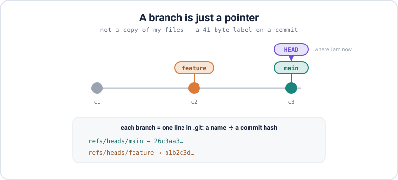
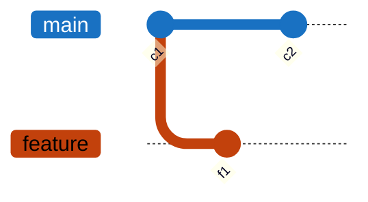

<div align="center">

# 06 · Branches

**Part 4 — Branching & Merging** · ✅ Done

</div>

> The biggest idea in Git, and the one I had backwards at first: a branch is just a movable pointer, not a copy of my files. Once that clicked, everything after it got easier.

### 📌 What's in here

| # | Topic | In one line |
|:-:|---|---|
| 1 | [A branch is a pointer](#1-a-branch-is-a-pointer) | It's a file holding one commit hash |
| 2 | [Create, switch, delete](#2-create-switch-delete) | `branch`, `switch`, `-d` vs `-D` |
| 3 | [Compare branches](#3-compare-branches) | `diff b1..b2` |
| 4 | [Stashing](#4-stashing) | Park work, switch, come back |
| ✔ | [Watch out](#-watch-out) · [Fix it](#-fix-it) · [Try it](#-try-it) · [What confused me](#-what-confused-me) | |

<p align="center"></p>

---

## 1. A branch is a pointer

A branch isn't a second copy of my project. It's a tiny file holding **one commit hash** — a label that points at a commit. I can prove it: make a branch, then read the files Git stores them in.

```bash
git branch feature
cat .git/refs/heads/main      # 26c8aa3341bf91f182f9f9a8517c29ecc85d6f15
cat .git/refs/heads/feature   # 26c8aa3341bf91f182f9f9a8517c29ecc85d6f15
```

Same hash — creating the branch copied **nothing**, it just wrote a 41-byte pointer at the commit I was on. `HEAD` is a separate pointer meaning "where I am now." When I commit, Git moves the current branch's pointer forward; when I switch, it moves `HEAD` to a different branch.



## 2. Create, switch, delete

```bash
git branch feature        # create a branch (does NOT switch to it)
git switch feature        # switch to it
git switch -c feature     # create AND switch, in one step
git checkout -b feature   # same, older syntax
git branch                # list branches (* marks the current one)
git branch -d feature     # delete — refuses if it has unmerged work
git branch -D feature     # force delete
```

```bash
git branch
#   feature
# * main
```

> [!NOTE]
> `git branch feature` **creates** a branch but leaves me on the current one — a classic "why am I still on main?" moment. Use `git switch -c feature` to create and move in one go. And lowercase `-d` is the safe delete: it refuses a branch with commits not merged anywhere, so I don't lose work. `-D` forces it.

## 3. Compare branches

```bash
git diff main..feature     # what's different between the two branches
```

## 4. Stashing

I'm mid-change on one branch — messy, not ready to commit — but I need to switch to another for a quick fix. **Stash** sets my changes aside so I get a clean working directory, and gives them back later.

```bash
git stash          # shelve my uncommitted changes → clean slate
git stash list     # see what's shelved
git stash pop      # bring them back AND remove the stash
git stash apply    # bring them back but keep the stash
git stash drop     # discard a stash without applying
```

```bash
git stash
# Saved working directory and index state WIP on main: 5a985df c2 on feature
git stash pop
# ... changes are back
```

---

## ⚠️ Watch out

- Creating a branch copies nothing — it's just a pointer.
- `git branch <name>` creates but **doesn't switch**. `git switch -c <name>` does both.
- `-d` refuses to delete an **unmerged** branch (it's protecting me); `-D` forces it.
- A stash is a temporary pocket, not a save point — commit anything important properly.

## 🔧 Fix it

Made a branch but you're still on `main`? Just switch to it:

```bash
git switch feature
```

## 🧪 Try it

> Prove to yourself that a branch is a pointer: make a repo with one commit, create a branch, and `cat` both ref files — they hold the same hash. Then switch to the branch, commit, switch back, and confirm `main` didn't move.

<details>
<summary>Show the answer</summary>

```bash
git init -b main && echo "x" > f.txt && git add . && git commit -m "c1"
git branch feature
cat .git/refs/heads/main .git/refs/heads/feature   # same hash

git switch feature
echo "y" >> f.txt && git commit -am "c2 on feature"
git switch main
git log --oneline      # main is still at c1 — the branches moved independently
```

</details>

## 🤔 What confused me

> That `git branch feature` doesn't move me onto the new branch. I kept running it and then committing, wondering why my commits were landing on `main`. `branch` only *creates* the pointer; I have to `switch` to it (or use `switch -c` to do both at once).

---

**One-line recap:** a branch is a 41-byte pointer to a commit, and `HEAD` marks the one I'm on. `git branch` creates, `git switch` moves, `switch -c` does both, `-d`/`-D` delete. Park half-done work with `git stash`.

---

[⬅ 05 · Investigating History](../05-investigating-history/README.md) · [🏠 Index](../README.md) · [07 · Merging ➡](../07-merging/README.md)
