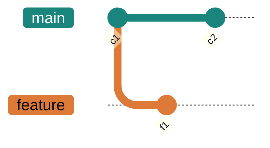

# 06 · Branches

> The biggest idea in Git, and the one I had backwards at first: a branch is just a movable pointer, not a copy of my files. Once that clicked, everything after it got easier.

**On this page:** [a branch is a pointer](#a-branch-is-a-pointer) · [create, switch, delete](#create-switch-delete) · [comparing branches](#comparing-branches) · [stashing](#stashing)

---

## A branch is a pointer

A branch isn't a second copy of my project. It's a tiny file holding **one commit hash** — a label that points at a commit. I can prove it: make a branch, then read the files Git stores them in.

```bash
git branch feature
cat .git/refs/heads/main      # 26c8aa3341bf91f182f9f9a8517c29ecc85d6f15
cat .git/refs/heads/feature   # 26c8aa3341bf91f182f9f9a8517c29ecc85d6f15
```

Same hash — creating the branch copied **nothing**, it just wrote a 41-byte pointer at the commit I was on.


`HEAD` is a separate pointer meaning "where I am now." When I commit, Git moves the current branch's pointer forward; when I switch, it moves `HEAD` to a different branch. Here's what it looks like once `main` and `feature` have each moved on:



## Create, switch, delete

```bash
git branch feature        # create a branch (does NOT switch to it)
git switch feature        # switch to it
git switch -c feature     # create AND switch, in one step
git checkout -b feature   # same, older syntax
git branch                # list branches (* marks the current one)
git branch -d feature     # delete — refuses if it has unmerged work
git branch -D feature     # force delete
```

```bash
git branch
#   feature
# * main
```

The one that catches me: `git branch feature` **creates** a branch but leaves me on the current one — a classic "why am I still on main?" moment — so I reach for `git switch -c feature` to create and move in one go. And lowercase `-d` is the safe delete: it refuses a branch with commits not merged anywhere, so I can't quietly lose work; `-D` forces it when I really mean it.

## Comparing branches

```bash
git diff main..feature     # what's different between the two branches
```

## Stashing

I'm mid-change on one branch — messy, not ready to commit — but I need to switch to another for a quick fix. **Stash** sets my changes aside so I get a clean working directory, and gives them back later:

```bash
git stash          # shelve my uncommitted changes → clean slate
git stash list     # see what's shelved
git stash pop      # bring them back AND remove the stash
git stash apply    # bring them back but keep the stash
git stash drop     # discard a stash without applying
```

```bash
git stash
# Saved working directory and index state WIP on main: 5a985df c2 on feature
git stash pop
# ... changes are back
```

A stash is a temporary pocket, not a save point — anything I actually care about I commit properly rather than leaving it stashed.

---

**What tripped me up:** that `git branch feature` doesn't move me onto the new branch. I kept running it and then committing, wondering why my commits were landing on `main`. `branch` only *creates* the pointer; I have to `switch` to it — or use `switch -c` to do both at once. Proving to myself that two branches started on the exact same hash (that `cat` trick above) is what finally made "a branch is just a pointer" stick.

---

[⬅ 05 · Investigating History](../05-investigating-history/README.md) · [🏠 Index](../README.md) · [07 · Merging ➡](../07-merging/README.md)
