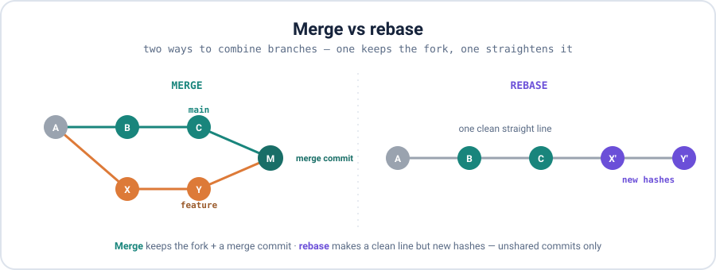
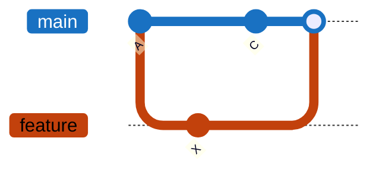

<div align="center">

# 07 · Merging

**Part 4 — Branching & Merging** · ✅ Done

</div>

> Bringing parallel work back together. Most merges just work; the skill is staying calm with the ones that don't — conflicts — and knowing when to rebase instead of merge.

### 📌 What's in here

| # | Topic | In one line |
|:-:|---|---|
| 1 | [Merge basics](#1-merge-basics) | `git merge <branch>` |
| 2 | [Fast-forward vs 3-way](#2-fast-forward-vs-3-way) | When a merge commit appears |
| 3 | [Conflicts](#3-conflicts) | The markers, and resolving them |
| 4 | [Squash & rebase](#4-squash--rebase) | Clean history + the new-hash gotcha |
| 5 | [Cherry-pick](#5-cherry-pick) | Grab a single commit |
| ✔ | [Watch out](#-watch-out) · [Fix it](#-fix-it) · [Try it](#-try-it) · [What confused me](#-what-confused-me) | |

<p align="center"></p>

---

## 1. Merge basics

`git merge` brings another branch's commits into the branch I'm currently on:

```bash
git switch main
git merge feature     # merge feature INTO main
```

## 2. Fast-forward vs 3-way

There are two ways a merge can happen.

**Fast-forward** — if `main` hasn't moved since I branched off, Git just **slides `main`'s pointer forward** to catch up. No merge commit; history stays a straight line.

```bash
git merge feature
# Updating 26c8aa3..5a985df
# Fast-forward
#  site.txt | 1 +
```

**Three-way** — if **both** branches moved on, Git can't just slide. It finds their **common ancestor**, combines the two sets of changes, and records a new **merge commit** with *two parents* (the diamond in the diagram).



```bash
git branch --merged      # branches already merged into this one
git branch --no-merged   # branches with work not yet merged
```

## 3. Conflicts

A conflict happens when **both branches changed the same lines** of the same file. Git can't guess which I want, so it stops and asks me — this isn't an error, it's Git handing me the decision.

```bash
git merge feature
# Auto-merging page.txt
# CONFLICT (content): Merge conflict in page.txt
# Automatic merge failed; fix conflicts and then commit the result.
```

It marks the spot in the file:

```
<<<<<<< HEAD
title: Welcome to our site
=======
title: Welcome to Venus
>>>>>>> feature
```

To resolve: edit the file so it holds exactly what I want, **delete all three marker lines**, then stage and commit:

```bash
nano page.txt          # keep the version(s) I want, remove <<<<<<< ======= >>>>>>>
git add page.txt       # mark it resolved
git commit             # completes the merge
```

> [!NOTE]
> Reading the markers: `<<<<<<< HEAD` to `=======` is **my** side (the current branch); `=======` to `>>>>>>> feature` is the **incoming** side. I can keep one, the other, both, or write something new — as long as all three marker lines are gone. Overwhelmed? `git merge --abort` rewinds to before the merge.

## 4. Squash & rebase

Two ways to make history tidier when I integrate a feature:

**Squash merge** — collapse all of a feature's commits into **one** commit on `main`:

```bash
git merge --squash feature
git commit -m "Add search feature"
```

**Rebase** — replay my branch's commits **on top of** another branch's latest commit, for a straight-line history:

```bash
git switch feature
git rebase main
```

> [!NOTE]
> **Rebase makes new commits with new hashes** — it rewrites history (that's the right side of the diagram). That's fine on commits only *I* have. But **never rebase commits I've already pushed or shared** — everyone else still has the old hashes, and the two histories collide. (More in Part 6.)

Which to use: **merge** keeps the true history and never rewrites (safe default). **Rebase** gives a clean line but rewrites — unshared commits only. **Squash** collapses a whole feature into one commit.

## 5. Cherry-pick

Sometimes I want *just one* commit from another branch — say a hotfix — without merging the whole branch:

```bash
git switch release
git cherry-pick a1b2c3d     # copy just that one commit onto release
```

And to grab just one *file* as it is on another branch:

```bash
git checkout main -- config.js   # pull that file from main into here
```

---

## ⚠️ Watch out

- Fast-forward happens **only** when the target branch hasn't moved. Otherwise it's a 3-way merge with a merge commit.
- A conflict isn't an error — Git is asking me to choose. I must remove **all** the `<<<<<<<` / `=======` / `>>>>>>>` lines.
- Rebase rewrites history (new hashes) — **unshared commits only**.
- `--squash` throws away the feature's individual commits; I get one combined commit.

## 🔧 Fix it

Merge going sideways mid-conflict? Rewind to exactly before it:

```bash
git merge --abort
```

## 🧪 Try it

> Make two branches that both change the same line, merge them, and resolve the conflict by hand. Then squash-merge a multi-commit feature into one commit on `main`.

<details>
<summary>Show the answer</summary>

```bash
# conflict
git init -b main && echo "title: Hello" > page.txt && git add . && git commit -m "base"
git switch -c feature && echo "title: Venus" > page.txt && git commit -am "feature title"
git switch main && echo "title: Our Site" > page.txt && git commit -am "main title"
git merge feature            # CONFLICT
nano page.txt                # fix it, remove the markers
git add page.txt && git commit

# squash
git merge --squash some-feature
git commit -m "Add the feature in one commit"
```

</details>

## 🤔 What confused me

> Why `git rebase` changes the commit hashes. A hash is built from the commit's content *including its parent*; rebase gives my commits new parents, so they become brand-new commits with new hashes. That's why it's fine locally but dangerous once the commits are shared — everyone else still has the old ones.

---

**One-line recap:** `git merge` combines branches — fast-forward if the target didn't move, a 3-way merge commit if both did. Resolve conflicts by editing out the markers, then `add` + `commit`. `--squash` collapses a feature, `rebase` straightens history (new hashes, unshared only), `cherry-pick` grabs one commit.

---

[⬅ 06 · Branches](../06-branches/README.md) · [🏠 Index](../README.md) · [08 · Remotes & GitHub ➡](../08-remotes-and-github/README.md)
