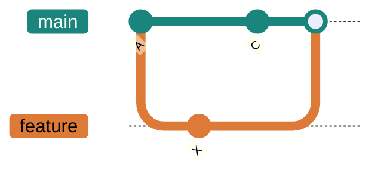

# 07 · Merging

> Bringing parallel work back together. Most merges just work; the skill is staying calm with the ones that don't — conflicts — and knowing when to rebase instead of merge.

**On this page:** [merge basics](#merge-basics) · [fast-forward vs 3-way](#fast-forward-vs-3-way) · [conflicts](#conflicts) · [squash & rebase](#squash-and-rebase) · [cherry-pick](#cherry-pick)

---

## Merge basics

`git merge` brings another branch's commits into the branch I'm currently on:

```bash
git switch main
git merge feature     # merge feature INTO main
```

## Fast-forward vs 3-way

There are two ways a merge can happen.

**Fast-forward** — if `main` hasn't moved since I branched off, Git just **slides `main`'s pointer forward** to catch up. No merge commit; history stays a straight line.

```bash
git merge feature
# Updating 26c8aa3..5a985df
# Fast-forward
#  site.txt | 1 +
```

**Three-way** — if **both** branches moved on, Git can't just slide. It finds their **common ancestor**, combines the two sets of changes, and records a new **merge commit** with *two parents*:



```bash
git branch --merged      # branches already merged into this one
git branch --no-merged   # branches with work not yet merged
```

## Conflicts

A conflict happens when **both branches changed the same lines** of the same file. Git can't guess which I want, so it stops and asks me — this isn't an error, it's Git handing me the decision.

```bash
git merge feature
# Auto-merging page.txt
# CONFLICT (content): Merge conflict in page.txt
# Automatic merge failed; fix conflicts and then commit the result.
```

It marks the spot in the file:

```
<<<<<<< HEAD
title: Welcome to our site
=======
title: Welcome to Venus
>>>>>>> feature
```

To resolve it, I edit the file so it holds exactly what I want, **delete all three marker lines**, then stage and commit:

```bash
nano page.txt          # keep the version(s) I want, remove <<<<<<< ======= >>>>>>>
git add page.txt       # mark it resolved
git commit             # completes the merge
```

Reading the markers: `<<<<<<< HEAD` to `=======` is **my** side (the current branch); `=======` to `>>>>>>> feature` is the **incoming** side. I can keep one, the other, both, or write something new — as long as all three marker lines are gone. And if it gets overwhelming, `git merge --abort` rewinds to exactly before the merge, no harm done.

## Squash and rebase

Two ways to make history tidier when I integrate a feature, and the diagram is the clearest way I've found to tell them apart:


**Squash merge** — collapse all of a feature's commits into **one** commit on `main`:

```bash
git merge --squash feature
git commit -m "Add search feature"
```

**Rebase** — replay my branch's commits **on top of** another branch's latest commit, for a straight-line history:

```bash
git switch feature
git rebase main
```

The catch that matters most: **rebase makes new commits with new hashes** — it rewrites history (that's the right side of the diagram). That's fine on commits only *I* have, but I **never rebase commits I've already pushed or shared** — everyone else still has the old hashes, and the two histories collide (more on this in Part 6). So: **merge** keeps the true history and never rewrites (my safe default), **rebase** gives a clean line but rewrites (unshared commits only), and **squash** collapses a whole feature into one commit.

## Cherry-pick

Sometimes I want *just one* commit from another branch — say a hotfix — without merging the whole branch:

```bash
git switch release
git cherry-pick a1b2c3d     # copy just that one commit onto release
```

And to grab just one *file* as it is on another branch:

```bash
git checkout main -- config.js   # pull that file from main into here
```

---

**What tripped me up:** why `git rebase` changes the commit hashes. A hash is built from the commit's content *including its parent*, and rebase gives my commits new parents — so they come out as brand-new commits with new hashes. That's exactly why it's safe locally but dangerous once the commits are shared: everyone else is still holding the old ones, and now there are two versions of the "same" history.

---

[⬅ 06 · Branches](../06-branches/README.md) · [🏠 Index](../README.md) · [08 · Remotes & GitHub ➡](../08-remotes-and-github/README.md)
