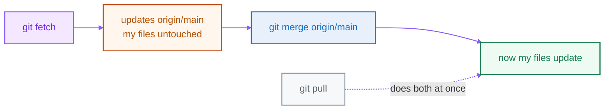

<div align="center">

# 08 · Remotes & GitHub

**Part 5 — Collaboration** · ✅ Done

</div>

> Everything so far was on my machine. Now I connect to GitHub to share and work with others. One idea makes all of it click: the remote-tracking branch, `origin/main`.

### 📌 What's in here

| # | Topic | In one line |
|:-:|---|---|
| 1 | [A remote & `origin/main`](#1-a-remote--originmain) | My cached view of the server |
| 2 | [Clone](#2-clone) | Copy a repo locally |
| 3 | [Fetch vs pull](#3-fetch-vs-pull) | Why fetch is safer |
| 4 | [Push & `-u`](#4-push---u) | Upload and set tracking |
| 5 | [SSH & credentials](#5-ssh--credentials) | No-password auth on Linux |
| 6 | [The rejected push](#6-the-rejected-push) | The one safe fix |
| ✔ | [Watch out](#-watch-out) · [Fix it](#-fix-it) · [Try it](#-try-it) · [What confused me](#-what-confused-me) | |

<p align="center"></p>

---

## 1. A remote & `origin/main`

A **remote** is a copy of my repo hosted somewhere others can reach — usually GitHub. By convention my main remote is nicknamed `origin`. But there's a *third* thing between my local branch and the server that beginners never hear about, and it's the key:

`origin/main` is **my local snapshot of where `main` was on the server the last time I checked**. It's not the server, and it's not my working `main` — it's a cached bookmark that Git updates only when I `fetch` or `pull`. Three lanes: my local main, the `origin/main` cache, and the real server (the diagram up top).

## 2. Clone

```bash
git clone https://github.com/me/project.git
# Cloning into 'project'...
```

Cloning downloads the full history **and** wires up the remote automatically — it names the server `origin` and creates my `origin/main` tracking branch. No manual setup:

```bash
git remote -v
# origin  https://github.com/me/project.git (fetch)
# origin  https://github.com/me/project.git (push)
```

## 3. Fetch vs pull



- `git fetch` — download new commits → updates **`origin/main` only**. My working files are untouched.
- `git pull` — `fetch` **plus** merge into my current branch, in one step.

The reason I often `fetch` first: it lets me *look at* the incoming changes (`git log origin/main`) before they touch my files — no surprises.

## 4. Push & `-u`

```bash
git push -u origin main
# * [new branch]      main -> main
# branch 'main' set up to track 'origin/main'.
```

> [!NOTE]
> `-u` (short for `--set-upstream`) links my local branch to `origin/main`, so Git remembers where it goes. After the first `push -u`, I can just type `git push` and `git pull` with no arguments. I only need `-u` the first time I publish a branch.

## 5. SSH & credentials

GitHub no longer accepts my **account password** from the command line. The smoothest fix is an **SSH key** — set it up once and never type a password again:

```bash
ssh-keygen -t ed25519 -C "me@example.com"   # press Enter for defaults
cat ~/.ssh/id_ed25519.pub                   # copy this, paste into
                                            # GitHub → Settings → SSH keys
ssh -T git@github.com                       # test — "Hi NAME! ...authenticated"
```

Then I use SSH-style URLs (`git@github.com:me/project.git`) and pushes stop asking for a password. (Over HTTPS instead, GitHub wants a **Personal Access Token** in place of the password.)

## 6. The rejected push

```bash
git push
# ! [rejected]        main -> main (fetch first)
# error: failed to push some refs ...
```

A rejected push means the server has commits I don't have yet — a teammate pushed. **The fix is never `--force`.** It's: get their work first, then push.

```bash
git fetch
git merge origin/main     # resolve any conflict (Part 7)
git push                  # now it succeeds
```

> [!NOTE]
> `git push --force` would make the server match *my* history, **deleting the commits my teammate pushed**. On a shared branch that's destructive. A rejected push just means "you're behind — go get the latest first."

---

## ⚠️ Watch out

- `origin/main` is a **cache** — it only updates when I `fetch` or `pull`, not automatically.
- GitHub needs a **token or SSH key**, not my account password.
- A rejected push → `fetch` + integrate, then push. **Never `--force`** on a shared branch.
- `-u` is only needed the **first** time I push a new branch.

## 🔧 Fix it

Push rejected as "non-fast-forward"? Get the latest, then push:

```bash
git fetch
git merge origin/main
git push
```

## 🧪 Try it

> Clone one of your GitHub repos, make a commit, and push it. Then edit the README directly on github.com (your "teammate"), run `git fetch`, and compare `git log origin/main` with `git log main` — see the difference fetch made before you merge.

<details>
<summary>Show the answer</summary>

```bash
git clone git@github.com:me/practice.git && cd practice
echo "a line" >> README.md
git commit -am "Update README"
git push

# after editing on github.com:
git fetch
git log --oneline main          # unchanged
git log --oneline origin/main   # the new commit is here
git merge origin/main           # now my files update
```

</details>

## 🤔 What confused me

> That `git fetch` doesn't change my files. I expected it to pull everything in, but it only updates `origin/main` — my cached view of the server. My actual branch and files don't move until I `merge` (or use `git pull`, which does both). Once I pictured `origin/main` as a separate cached lane, fetch/pull/push stopped being confusing.

---

**One-line recap:** a remote (`origin`) is the shared copy; `origin/main` is my cached view of it. `clone` wires it up, `fetch` updates the cache, `pull` = fetch + merge, `push -u` uploads and sets tracking. Auth with SSH; recover a rejected push with fetch + integrate, never `--force`.

---

[⬅ 07 · Merging](../07-merging/README.md) · [🏠 Index](../README.md) · [09 · Pull Requests & Open Source ➡](../09-pull-requests-and-open-source/README.md)
