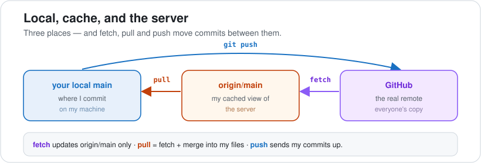
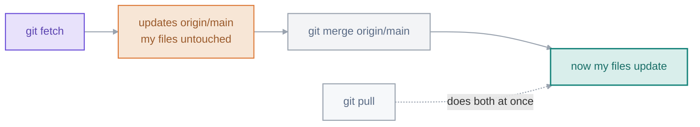

# 08 · Remotes & GitHub

> Everything so far was on my machine. Now I connect to GitHub to share and work with others. One idea makes all of it click: the remote-tracking branch, `origin/main`.

**On this page:** [remotes & origin/main](#a-remote-and-originmain) · [clone](#clone) · [fetch vs pull](#fetch-vs-pull) · [push & -u](#push-and--u) · [SSH & credentials](#ssh-and-credentials) · [the rejected push](#the-rejected-push)

---

## A remote and origin/main

A **remote** is a copy of my repo hosted somewhere others can reach — usually GitHub. By convention my main remote is nicknamed `origin`. But there's a *third* thing between my local branch and the server that beginners never hear about, and it's the key to everything else on this page:

`origin/main` is **my local snapshot of where `main` was on the server the last time I checked**. It's not the server, and it's not my working `main` — it's a cached bookmark that Git updates only when I `fetch` or `pull`.



Once I pictured those three lanes — local, cache, server — the whole fetch/pull/push dance stopped feeling arbitrary.

## Clone

```bash
git clone https://github.com/me/project.git
# Cloning into 'project'...
```

Cloning downloads the full history **and** wires up the remote automatically — it names the server `origin` and creates my `origin/main` tracking branch, no manual setup:

```bash
git remote -v
# origin  https://github.com/me/project.git (fetch)
# origin  https://github.com/me/project.git (push)
```

## Fetch vs pull



`git fetch` downloads new commits and updates **`origin/main` only** — my working files are untouched. `git pull` is `fetch` **plus** a merge into my current branch, in one step. I often `fetch` first on purpose: it lets me *look at* the incoming changes (`git log origin/main`) before they touch my files, so there are no surprises.

## Push and -u

```bash
git push -u origin main
# * [new branch]      main -> main
# branch 'main' set up to track 'origin/main'.
```

`-u` (short for `--set-upstream`) links my local branch to `origin/main` so Git remembers where it goes. After the first `push -u`, plain `git push` and `git pull` work with no arguments — I only need `-u` the first time I publish a branch.

## SSH and credentials

GitHub no longer accepts my **account password** from the command line. The smoothest fix is an **SSH key** — set it up once and never type a password again:

```bash
ssh-keygen -t ed25519 -C "me@example.com"   # press Enter for defaults
cat ~/.ssh/id_ed25519.pub                   # copy this, paste into
                                            # GitHub → Settings → SSH keys
ssh -T git@github.com                       # test — "Hi NAME! ...authenticated"
```

Then I use SSH-style URLs (`git@github.com:me/project.git`) and pushes stop asking for a password. (If I'm on HTTPS instead, GitHub wants a **Personal Access Token** in place of the password.)

## The rejected push

```bash
git push
# ! [rejected]        main -> main (fetch first)
# error: failed to push some refs ...
```

A rejected push means the server has commits I don't have yet — a teammate pushed. **The fix is never `--force`.** It's to get their work first, then push:

```bash
git fetch
git merge origin/main     # resolve any conflict (Part 7)
git push                  # now it succeeds
```

`git push --force` would make the server match *my* history, **deleting the commits my teammate pushed** — on a shared branch that's destructive. A rejected push is just Git saying "you're behind — go get the latest first."

---

**What tripped me up:** that `git fetch` doesn't change my files. I expected it to pull everything in, but it only updates `origin/main` — my cached view of the server. My actual branch and files don't move until I `merge` (or `git pull`, which does both). The moment I started picturing `origin/main` as a separate cached lane, fetch, pull and push all stopped being confusing.

---

[⬅ 07 · Merging](../07-merging/README.md) · [🏠 Index](../README.md) · [09 · Pull Requests & Open Source ➡](../09-pull-requests-and-open-source/README.md)
