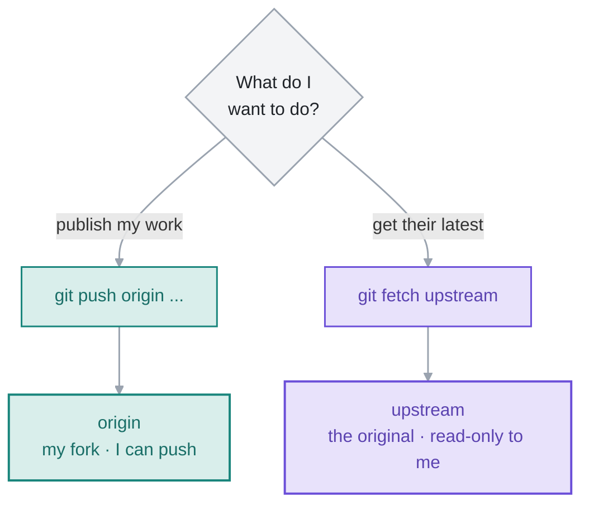

# 09 · Pull Requests & Open Source

> A pull request is how I propose changes instead of just pushing them. On my own repo it's optional; on a project I don't own, it's the *only* way in — and that's where the fork workflow comes in.

**On this page:** [what a PR is](#what-a-pr-actually-is) · [the fork workflow](#the-fork-workflow) · [origin vs upstream](#origin-vs-upstream) · [keeping my fork current](#keeping-my-fork-current) · [issues, labels & releases](#issues-labels-and-releases)

---

## What a PR actually is

A **pull request** isn't a Git command — it's a GitHub feature. It's me saying: *"here's a branch with my changes, please review it and merge it into yours."*

The mechanics are all stuff from earlier parts — I make a branch, commit on it, push it. The PR is just the conversation wrapped around that branch: a place to review the diff, discuss it, and merge it when it's approved.

```bash
git switch -c fix-typo      # a branch for the change
# ...edit, commit...
git push -u origin fix-typo # push the branch
# GitHub then prints a link to open the PR
```

On a repo I own I don't *need* a PR — I could merge locally and push — but opening one anyway gives me the diff view, a checklist, and CI running before anything lands on `main`. On a repo I **don't** own, a PR is the only door in: I can't push to someone else's project directly.

## The fork workflow

Here's the problem: I want to contribute to a project on GitHub, but I have no push access to it. I can't just `git push` to someone else's repo.

A **fork** solves it. Forking makes my own full copy of the project under my account — I *can* push to that copy — and then I open a PR from my copy back to the original.


So the loop is: **fork** the project on GitHub (now I have my own copy), **clone** my fork to my machine, **branch → commit → push** to my fork, then **open a PR** from my fork's branch to the original. The maintainer reviews it, and if they like it, *they* merge it. I never needed write access to their repo.

## origin vs upstream

After I clone my fork, there's only one remote — `origin`, pointing at **my copy**:

```bash
git remote -v
# origin  https://github.com/me/project.git (fetch)
# origin  https://github.com/me/project.git (push)
```

But my fork is a frozen snapshot from the moment I forked, and the real project keeps moving. So I add a **second** remote, by convention named `upstream`, pointing at the **original**:

```bash
git remote add upstream https://github.com/original/project.git
git remote -v
# origin    https://github.com/me/project.git       (fetch)
# origin    https://github.com/me/project.git       (push)
# upstream  https://github.com/original/project.git (fetch)
# upstream  https://github.com/original/project.git (push)
```

Now the two remotes have clear jobs — **`origin` is mine, I push to it; `upstream` is theirs, I fetch from it** — and I never push to `upstream`, because I don't have access and that's the whole point:



## Keeping my fork current

Because the original moves on without me, my fork goes stale. Before I start new work I pull in `upstream`'s latest so I'm branching off current code, not last month's:

```bash
git switch main
git fetch upstream            # grab the original's new commits
git merge upstream/main       # bring them into my local main
git push origin main          # update my fork on GitHub too
```

Then I branch off that fresh `main` for my change — doing this first means fewer conflicts when the maintainer comes to merge my PR. I keep one branch per change (`fix-typo`, `add-search`, …) and leave `main` as a clean mirror of upstream, so each PR is one focused thing and I can have several in flight without them tangling. If I ever slip and commit straight onto my fork's `main`, I rescue it by tagging that spot as a branch and resetting `main` back to the original:

```bash
git branch my-feature            # mark the current spot as a branch
git switch main
git reset --hard upstream/main   # put main back to match the original
git switch my-feature            # my commits are safe here
```

## Issues, labels and releases

PRs are the code side; the rest of GitHub is how a project stays organised:

- **Issues** — a bug report or feature request, a to-do list anyone can add to. A PR can close one automatically: put `Closes #42` in the description and merging it closes issue 42.
- **Labels** — tags on issues/PRs (`bug`, `good first issue`, `help wanted`). `good first issue` is the one I filter on when I'm looking for somewhere to start contributing — maintainers scope those small on purpose, because they *want* first-timers.
- **Milestones** — a bucket of issues grouped toward a goal, like `v2.0`.
- **Releases** — a snapshot of the project at a point in time, built on a **tag** (from module 05). A release turns tag `v1.0` into a download page with notes.

---

**What tripped me up:** that `origin` doesn't mean "the original." I assumed `origin` always pointed at the real project — but after a fork, `origin` is **my copy**, and the real project is `upstream`. Naming it the other way round would have made more sense to me, but the rule is simply: `origin` is the one I cloned from (always my fork here), `upstream` is the one I'm contributing to.

---

[⬅ 08 · Remotes & GitHub](../08-remotes-and-github/README.md) · [🏠 Index](../README.md) · [10 · Rewriting History ➡](../10-rewriting-history/README.md)
