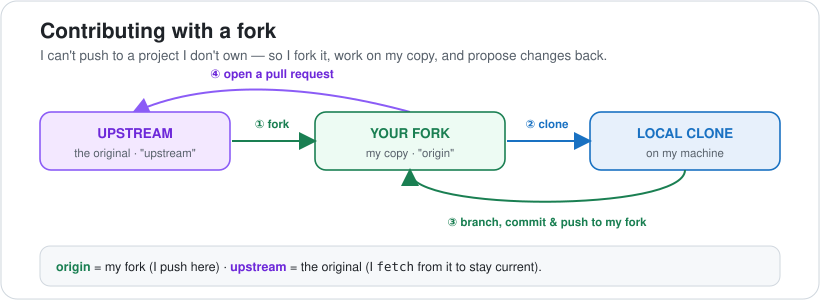
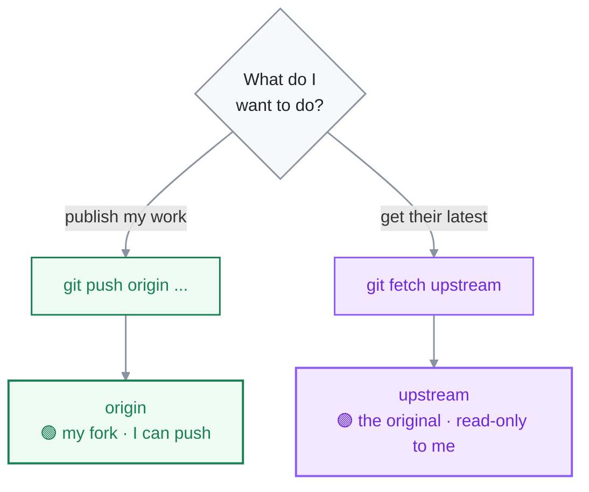

<div align="center">

# 09 · Pull Requests & Open Source

**Part 5 — Collaboration** · ✅ Done

</div>

> A pull request is how I propose changes instead of just pushing them. On my own repo it's optional; on a project I don't own, it's the *only* way in — and that's where the fork workflow comes in.

### 📌 What's in here

| # | Topic | In one line |
|:-:|---|---|
| 1 | [What a PR actually is](#1-what-a-pr-actually-is) | A request to merge a branch |
| 2 | [The fork workflow](#2-the-fork-workflow) | Contributing to a repo I can't push to |
| 3 | [`origin` vs `upstream`](#3-origin-vs-upstream) | Two remotes, two jobs |
| 4 | [Keeping my fork current](#4-keeping-my-fork-current) | Sync before I branch |
| 5 | [Issues, labels & releases](#5-issues-labels--releases) | The rest of GitHub's collaboration layer |
| ✔ | [Watch out](#-watch-out) · [Fix it](#-fix-it) · [Try it](#-try-it) · [What confused me](#-what-confused-me) | |

<p align="center"></p>

---

## 1. What a PR actually is

A **pull request** isn't a Git command — it's a GitHub feature. It's me saying: *"here's a branch with my changes, please review it and merge it into yours."*

The mechanics are all stuff from earlier parts: I make a branch, commit on it, push it. The PR is just the conversation wrapped around that branch — a place to review the diff, discuss it, and merge it when it's approved.

```bash
git switch -c fix-typo      # a branch for the change
# ...edit, commit...
git push -u origin fix-typo # push the branch
# GitHub then prints a link to open the PR
```

> [!NOTE]
> On a repo I own, I don't *need* a PR — I could merge locally and push. But opening one anyway gives me the diff view, a checklist, and CI running before anything lands on `main`. On a repo I **don't** own, a PR is the only door in — I can't push to someone else's project directly.

## 2. The fork workflow

Here's the problem: I want to contribute to a project on GitHub, but I have no push access to it. I can't just `git push` to someone else's repo.

A **fork** solves it. Forking makes my own full copy of the project under my account. I *can* push to that copy — and then I open a PR from my copy back to the original. The whole flow is in the diagram up top:

1. **Fork** the project on GitHub → now I have my own copy.
2. **Clone** my fork to my machine.
3. **Branch**, make the change, **commit**, and **push** — to my fork.
4. **Open a PR** from my fork's branch to the original project.

The maintainer reviews it, and if they like it, *they* merge it. I never needed write access to their repo.

## 3. `origin` vs `upstream`

After I clone my fork, there's only one remote — `origin`, pointing at **my copy**:

```bash
git remote -v
# origin  https://github.com/me/project.git (fetch)
# origin  https://github.com/me/project.git (push)
```

But my fork is a frozen snapshot from the moment I forked — the real project keeps moving. So I add a **second** remote, by convention named `upstream`, pointing at the **original**:

```bash
git remote add upstream https://github.com/original/project.git
git remote -v
# origin    https://github.com/me/project.git       (fetch)
# origin    https://github.com/me/project.git       (push)
# upstream  https://github.com/original/project.git (fetch)
# upstream  https://github.com/original/project.git (push)
```

Now the two remotes have clear jobs: **`origin` is mine — I push to it. `upstream` is theirs — I fetch from it.** I never push to `upstream`; I don't have access, and that's the whole point.



## 4. Keeping my fork current

Because the original moves on without me, my fork goes stale. Before I start new work I pull in `upstream`'s latest so I'm branching off current code, not last month's:

```bash
git switch main
git fetch upstream            # grab the original's new commits
git merge upstream/main       # bring them into my local main
git push origin main          # update my fork on GitHub too
```

Then I branch off that fresh `main` for my change. Doing this first means fewer conflicts when the maintainer comes to merge my PR.

> [!TIP]
> One branch per change. I keep my `main` clean (just a mirror of upstream) and do every piece of work on its own branch — `fix-typo`, `add-search`, etc. That way each PR is one focused thing, and I can have several in flight without them tangling.

## 5. Issues, labels & releases

PRs are the code side. The rest of GitHub is how a project stays organised:

- **Issues** — a bug report or feature request. A to-do list for the project that anyone can add to. A PR can close one automatically: put `Closes #42` in the PR description and merging it closes issue 42.
- **Labels** — tags on issues/PRs (`bug`, `good first issue`, `help wanted`). `good first issue` is the one to filter on when I'm looking for somewhere to start contributing.
- **Milestones** — a bucket of issues grouped toward a goal, like `v2.0`.
- **Releases** — a snapshot of the project at a point in time, built on a **tag** (Part 5's neighbour — tags are from module 05). A release turns tag `v1.0` into a download page with notes.

> [!NOTE]
> `good first issue` exists because maintainers *want* first-time contributors. Filtering issues by that label is the normal way people make their first open-source PR — the work is scoped small on purpose.

---

## ⚠️ Watch out

- I **can't push** to a repo I don't own — fork it, push to the fork, then PR. There's no shortcut.
- After cloning a fork, `origin` is **my fork**, not the original. Add `upstream` myself.
- **Never push to `upstream`** — I fetch from it, that's all.
- A stale fork causes merge conflicts. Sync `upstream/main` *before* branching, not after.
- One PR = one change on its own branch. Don't pile unrelated work onto one branch.

## 🔧 Fix it

Accidentally committed on `main` of my fork instead of a branch? Move the work onto a branch and reset `main`:

```bash
git branch my-feature        # mark the current spot as a branch
git switch main
git reset --hard upstream/main   # put main back to match the original
git switch my-feature            # my commits are safe here
```

## 🧪 Try it

> Find a repo on GitHub with a `good first issue`, fork it, clone your fork, and add `upstream`. Run `git remote -v` and confirm `origin` is your copy and `upstream` is the original. Then sync `upstream/main` into your fork.

<details>
<summary>Show the answer</summary>

```bash
# after clicking "Fork" on github.com:
git clone git@github.com:me/their-project.git && cd their-project
git remote add upstream git@github.com:them/their-project.git
git remote -v
# origin    ...me/their-project.git     (mine)
# upstream  ...them/their-project.git   (theirs)

git fetch upstream
git switch main
git merge upstream/main
git push origin main          # fork now matches the original
```

</details>

## 🤔 What confused me

> That `origin` doesn't mean "the original." I assumed `origin` always pointed at the real project — but after a fork, `origin` is **my copy**, and the real project is `upstream`. Naming it the other way round would've made more sense to me, but the rule is just: `origin` = the one I cloned from (always my fork here), `upstream` = the one I'm contributing to.

---

**One-line recap:** a PR proposes merging a branch. To contribute to a repo I can't push to, I **fork** it, clone my fork (`origin`), add the original as `upstream`, branch + push to `origin`, then open a PR to `upstream`. I fetch from `upstream` to stay current and never push to it. Issues, labels, milestones and releases organise the rest.

---

[⬅ 08 · Remotes & GitHub](../08-remotes-and-github/README.md) · [🏠 Index](../README.md) · [10 · Rewriting History ➡](../10-rewriting-history/README.md)
