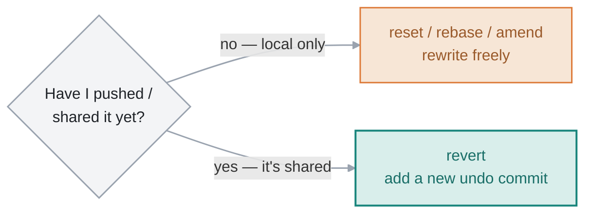

# 10 · Rewriting History

> Git lets me go back and change commits — fix a message, undo a change, squash a messy series into one clean commit. It's powerful and a little scary, so there's one rule that keeps it safe, and one command (`reflog`) that saves me when it isn't.

**On this page:** [the golden rule](#the-golden-rule) · [amend](#amend) · [reset](#reset) · [revert](#revert) · [reflog](#reflog-the-safety-net) · [interactive rebase](#interactive-rebase)

---

## The golden rule

> **Never rewrite history that I've already shared.**

Everything on this page *rewrites* commits — gives them new hashes, moves them, deletes them. That's completely fine on commits that live **only on my machine**. But once I've pushed commits and someone else has them, rewriting them means my history and theirs no longer match, and the next push collides — or worse, I force it and wipe their work.

So the split is simple: **local-only commits, rewrite freely; shared commits, use `revert` (below), never reset or rebase.**

## Amend

The smallest rewrite: fix the **most recent** commit. Wrong message, or forgot a file?

```bash
git commit --amend -m "Add second line (reworded)"
# [main 513a86b] Add second line (reworded)
```

To add a forgotten file to the last commit, stage it first, then amend:

```bash
git add forgotten.txt
git commit --amend --no-edit     # --no-edit keeps the existing message
```

`--amend` doesn't *edit* the old commit — it **replaces** it with a new one (new hash). So it's a history rewrite too, and the golden rule applies: only amend a commit I haven't pushed.

## Reset

`git reset` moves the branch pointer to an earlier commit. The flag decides how much it drags back with it:


```bash
git reset --soft  HEAD~1   # undo the commit, keep changes staged
git reset --mixed HEAD~1   # undo the commit, unstage (the default)
git reset --hard  HEAD~1   # undo the commit AND discard the changes ⚠
```

`--soft` moves HEAD back but my changes stay **staged**, ready to recommit — great for "I committed too early." `--mixed` (the default) moves HEAD back and **unstages**, so the changes stay in my files, just not staged. `--hard` moves HEAD back and **throws the changes away** — the only destructive one, and the single Git command that deletes uncommitted work with no normal undo. Committed work it rewinds past is still in the reflog (below); uncommitted edits are gone. I always double-check before running it.

## Revert

`reset` rewrites history, so it's unsafe on shared branches. `revert` is the safe alternative: instead of removing the bad commit, it adds a **new** commit that undoes it.

```bash
git revert HEAD
# [main 6b5287a] Revert "Add second line (reworded)"
#  1 file changed, 1 deletion(-)
```

History stays intact — the bad commit is still there, followed by a commit that cancels it out. Nobody's commits get rewritten, so there's no collision. This is the undo I use on `main` and any pushed branch:



## Reflog, the safety net

Here's the thing that makes all of this safe to experiment with: **Git records every move `HEAD` makes** — every commit, reset, rebase, checkout — in the **reflog**. Even when a commit looks "lost" after a `reset --hard`, its hash is still sitting right here:

```bash
git reflog
# 571fbea HEAD@{0}: commit: Bad commit I regret
# 0f252ec HEAD@{1}: commit: Add second line
# a18de5d HEAD@{2}: commit (initial): Add notes
```

So recovering from a reset I regret is two steps — find the hash in the reflog, reset back to it:

```bash
git reflog                 # find the commit I "lost"
git reset --hard 571fbea   # bring it back
```

Whenever I think I've destroyed work with `reset`, `rebase`, or a bad merge, I **check `reflog` before panicking** — the commits are almost always still there for a couple of weeks. This single command has saved me more than any other in Git.

## Interactive rebase

The power tool. `git rebase -i` lets me rewrite a *series* of recent commits — reword them, squash several into one, reorder, or drop them entirely. I pick how many commits back to go:

```bash
git rebase -i HEAD~3
```

It opens an editor with one line per commit, oldest at the top, and I change the **verb** at the start of each line:

```
pick 0f252ec Add second line
pick 513a86b Add second line (reworded)
pick 6b5287a Revert "Add second line (reworded)"
```

The verbs I actually use:

| verb | what it does |
|---|---|
| `pick` | keep the commit as-is |
| `reword` | keep it, but edit the message |
| `squash` | merge it into the commit above (keep both messages) |
| `fixup` | like squash, but drop this commit's message |
| `edit` | stop here so I can change the commit |
| `drop` | delete the commit |

The classic use: I made five scrappy "wip" commits building one feature, and I want them to land as **one** clean commit. Change the first to `pick` and the rest to `squash` (or `fixup`), save, and Git melds them together. Same golden rule — only on commits I haven't pushed.

---

**What tripped me up:** the difference between `reset` and `revert`. They both "undo," but `reset` **rewrites** history (moves the pointer, as if the commit never happened) while `revert` **adds** a new commit that cancels the old one out. Reset is for cleaning up my own local mess; revert is for undoing something that's already shared. Once I tied each one to "local vs shared," picking between them stopped being a guess.

---

[⬅ 09 · Pull Requests & Open Source](../09-pull-requests-and-open-source/README.md) · [🏠 Index](../README.md) · [Recovery Guide ➡](../appendix-recovery/README.md)
