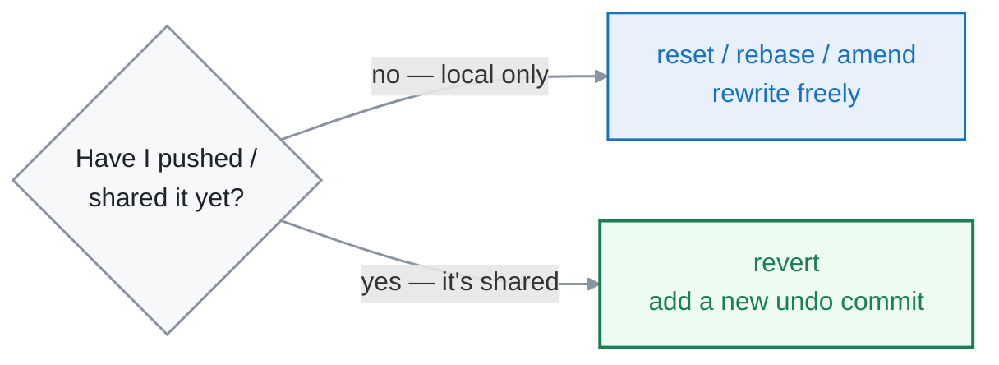
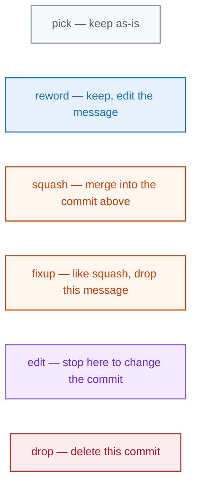

<div align="center">

# 10 · Rewriting History

**Part 6 — Rewriting History** · ✅ Done

</div>

> Git lets me go back and change commits — fix a message, undo a change, squash a messy series into one clean commit. It's powerful and a little scary, so there's one rule that keeps it safe, and one command (`reflog`) that saves me when it isn't.

### 📌 What's in here

| # | Topic | In one line |
|:-:|---|---|
| 1 | [The Golden Rule](#1-the-golden-rule) | Never rewrite *shared* history |
| 2 | [Amend](#2-amend) | Fix the last commit |
| 3 | [Reset](#3-reset) | Move the branch pointer back |
| 4 | [Revert](#4-revert) | Undo safely on a shared branch |
| 5 | [Reflog — the safety net](#5-reflog--the-safety-net) | Nothing is really lost |
| 6 | [Interactive rebase](#6-interactive-rebase) | Reword, squash, reorder, drop |
| ✔ | [Watch out](#-watch-out) · [Fix it](#-fix-it) · [Try it](#-try-it) · [What confused me](#-what-confused-me) | |

<p align="center"></p>

---

## 1. The Golden Rule

> **Never rewrite history that I've already shared.**

Everything in this page *rewrites* commits — gives them new hashes, moves them, deletes them. That's completely fine on commits that live **only on my machine**. But once I've pushed commits and someone else has them, rewriting them means my history and theirs no longer match, and the next push collides (or worse, I force it and wipe their work).

So the split is simple: **local-only commits — rewrite freely. Shared commits — use `revert` (section 4), never reset or rebase.**

## 2. Amend

The smallest rewrite: fix the **most recent** commit. Wrong message, or forgot a file?

```bash
git commit --amend -m "Add second line (reworded)"
# [main 513a86b] Add second line (reworded)
```

To add a forgotten file to the last commit: stage it first, then amend:

```bash
git add forgotten.txt
git commit --amend --no-edit     # --no-edit keeps the existing message
```

> [!NOTE]
> `--amend` doesn't *edit* the old commit — it **replaces** it with a new one (new hash). So it's a history rewrite too, and the Golden Rule applies: only amend a commit I haven't pushed.

## 3. Reset

`git reset` moves the branch pointer to an earlier commit. The flag decides how much it drags back with it — that's the whole diagram up top:

```bash
git reset --soft  HEAD~1   # undo the commit, keep changes staged
git reset --mixed HEAD~1   # undo the commit, unstage (the default)
git reset --hard  HEAD~1   # undo the commit AND discard the changes ⚠
```

- **`--soft`** — moves HEAD back; my changes stay **staged**, ready to recommit. Great for "I committed too early."
- **`--mixed`** (default) — moves HEAD back and **unstages**; changes stay in my files, just not staged.
- **`--hard`** — moves HEAD back and **throws the changes away**. The only destructive one.

> [!WARNING]
> `--hard` is the one command in Git that deletes uncommitted work with no undo through normal means. Committed work it rewinds past is still in the reflog (section 5) — but uncommitted edits are gone. I double-check before I run it.

## 4. Revert

`reset` rewrites history, so it's unsafe on shared branches. `revert` is the safe alternative: instead of removing the bad commit, it adds a **new** commit that undoes it.

```bash
git revert HEAD
# [main 6b5287a] Revert "Add second line (reworded)"
#  1 file changed, 1 deletion(-)
```

History stays intact — the bad commit is still there, followed by a commit that cancels it out. Nobody's commits get rewritten, so there's no collision. **This is the undo I use on `main` and any pushed branch.**



## 5. Reflog — the safety net

Here's the thing that makes all of this safe to experiment with: **Git records every move `HEAD` makes** — every commit, reset, rebase, checkout — in the **reflog**. Even when a commit looks "lost" after a `reset --hard`, its hash is still sitting right here:

```bash
git reflog
# 571fbea HEAD@{0}: commit: Bad commit I regret
# 0f252ec HEAD@{1}: commit: Add second line
# a18de5d HEAD@{2}: commit (initial): Add notes
```

So recovering from a reset I regret is two steps — find the hash in the reflog, reset back to it:

```bash
git reflog                 # find the commit I "lost"
git reset --hard 571fbea   # bring it back
```

> [!TIP]
> Whenever I think I've destroyed work with `reset`, `rebase`, or a bad merge — **check `reflog` first, before panicking.** The commits are almost always still there for a couple of weeks. This single command has saved me more than any other.

## 6. Interactive rebase

The power tool. `git rebase -i` lets me rewrite a *series* of recent commits — reword them, squash several into one, reorder, or drop them entirely. I pick how many commits back to go:

```bash
git rebase -i HEAD~3
```

It opens an editor with one line per commit, oldest at the top. I change the **verb** at the start of each line:

```
pick 0f252ec Add second line
pick 513a86b Add second line (reworded)
pick 6b5287a Revert "Add second line (reworded)"
```

The verbs I actually use:



The classic use: I made five scrappy "wip" commits building one feature, and I want them to land as **one** clean commit. Change the first to `pick` and the rest to `squash` (or `fixup`), save, and Git melds them together. Same Golden Rule — only on commits I haven't pushed.

---

## ⚠️ Watch out

- **The Golden Rule:** never `reset`, `rebase`, or `amend` commits I've already pushed/shared. Use `revert` there.
- `reset --hard` **deletes uncommitted changes** with no normal undo. Commit or stash first if unsure.
- `--amend` and `rebase` make **new hashes** — they replace commits, they don't edit them.
- `revert` doesn't remove the bad commit; it adds an undo commit *after* it. History stays honest.
- Lost a commit? **`reflog` before you panic** — it's almost certainly still there.

## 🔧 Fix it

Ran `reset --hard` and lost commits? Find them in the reflog and reset back:

```bash
git reflog
git reset --hard HEAD@{1}     # or the exact hash you see listed
```

## 🧪 Try it

> Make three commits, then `reset --hard` back past all of them. Confirm they look gone with `git log`, then recover the latest one from `git reflog`. Finally, squash two local commits into one with `git rebase -i`.

<details>
<summary>Show the answer</summary>

```bash
git init -b main
echo a > f.txt && git add . && git commit -m "one"
echo b >> f.txt && git commit -am "two"
echo c >> f.txt && git commit -am "three"

LATEST=$(git rev-parse HEAD)
git reset --hard HEAD~3        # all three "gone"
git log --oneline             # empty / initial
git reflog                     # they're all still here
git reset --hard $LATEST       # back to all three

git rebase -i HEAD~2           # set the 2nd line to "squash", save
```

</details>

## 🤔 What confused me

> The difference between `reset` and `revert`. They both "undo," but `reset` **rewrites** history (moves the pointer, as if the commit never happened) while `revert` **adds** a new commit that cancels the old one out. Reset is for cleaning up my own local mess; revert is for undoing something that's already shared. Once I tied each to "local vs shared," picking between them stopped being a guess.

---

**One-line recap:** rewriting history is safe on local-only commits, never on shared ones (the Golden Rule — use `revert` there). `amend` fixes the last commit, `reset` moves the branch back (`--soft`/`--mixed` keep work, `--hard` discards it), `revert` adds a safe undo commit, `rebase -i` rewords/squashes/reorders/drops a series — and `reflog` gets back almost anything I lose along the way.

---

[⬅ 09 · Pull Requests & Open Source](../09-pull-requests-and-open-source/README.md) · [🏠 Index](../README.md) · [⛑ Recovery Guide ➡](../appendix-recovery/README.md)
