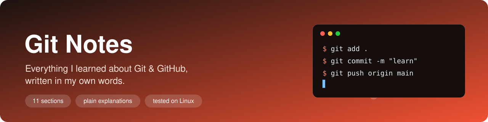

<div align="center">



<br><br>


</div>

## 👋 About these notes

My notes on Git and GitHub, from `git init` to interactive rebase, written as I learned the tool.

I keep them for two reasons:

- **A reference for myself** — when I forget a flag or how something works, I check here before I google it.
- **A record of what I've learned** — snapshots, branching, the fork workflow, rewriting history, and getting out of mistakes.

> [!NOTE]
> **Every command's output here is real.** Git runs on my own machine (Linux Mint), so I actually ran everything you see — the output is what my terminal printed, not made up.

These are student notes, written as I go. If you spot a mistake, open an issue — I'd like to fix it.

## 🗺️ What's covered

**Progress:** `█████████████████░░░░░░░░░░` 7 / 11
&nbsp;&nbsp;·&nbsp;&nbsp; ✅ written &nbsp; 🚧 being written &nbsp; ⬜ not yet

### Part 1 — Foundations

What Git is and how it thinks, before any command.

| # | Section | What's inside | Status |
|:-:|---|---|:-:|
| 01 | [What is Git](01-what-is-git/README.md) | VCS, centralized vs distributed, snapshots not diffs, install & config | ✅ |

### Part 2 — The Core Workflow

The everyday loop: snapshotting your project, and undoing when needed.

| # | Section | What's inside | Status |
|:-:|---|---|:-:|
| 02 | [Creating Snapshots](02-creating-snapshots/README.md) | `init`, the three areas, `add`/`commit`, the commit object, atomic commits | ✅ |
| 03 | [Inspecting & Undoing](03-inspecting-and-undoing/README.md) | `diff` vs `--staged`, `rm --cached` + `.gitignore`, `mv`, the three undos | ✅ |

### Part 3 — Browsing History

Finding what you need in history, and tracking down when something changed.

| # | Section | What's inside | Status |
|:-:|---|---|:-:|
| 04 | [Reading & Filtering History](04-reading-and-filtering-history/README.md) | `log` shaping, `--author`/`--grep`/`-S`, ranges, aliases | ✅ |
| 05 | [Investigating History](05-investigating-history/README.md) | `HEAD~n`, detached HEAD, `bisect`, `blame`, restoring deleted files, tags | ✅ |

### Part 4 — Branching & Merging

Parallel work, and bringing it back together.

| # | Section | What's inside | Status |
|:-:|---|---|:-:|
| 06 | [Branches](06-branches/README.md) | Branches as movable pointers, create/switch/delete, compare, stash | ✅ |
| 07 | [Merging](07-merging/README.md) | Fast-forward vs 3-way, conflicts, squash, rebase, cherry-pick | ✅ |

### Part 5 — Collaboration

Working with a remote, and with other people.

| # | Section | What's inside | Status |
|:-:|---|---|:-:|
| 08 | [Remotes & GitHub](08-remotes-and-github/README.md) | `origin/main`, clone/fetch/pull/push, SSH, the rejected-push fix | 🚧 |
| 09 | [Pull Requests & Open Source](09-pull-requests-and-open-source/README.md) | PRs, issues/labels/milestones, the fork → upstream → PR flow | 🚧 |

### Part 6 — Rewriting History

Cleaning up before you share, and getting out of any mistake.

| # | Section | What's inside | Status |
|:-:|---|---|:-:|
| 10 | [Rewriting History](10-rewriting-history/README.md) | The Golden Rule, `reflog`, `reset`, `revert`, `amend`, interactive rebase | 🚧 |

### Appendix

| Section | What's inside | Status |
|---|---|:-:|
| [⛑ Recovery Guide — I Screwed Up, Now What?](appendix-recovery/README.md) | Symptom → fix for every common disaster, tagged safe vs shared-history care | 🚧 |

## 🧭 How every page is structured

Each topic uses the same layout, so the notes read the same way throughout (full template in [TEMPLATE.md](TEMPLATE.md)):

| Part | What it covers |
|---|---|
| **What it is** | A plain-English definition |
| **Why it exists** | The problem it solves |
| **Key points** | The core ideas, broken down, with real commands |
| **Visual** | A hand-made SVG diagram, plus Mermaid where it helps |
| **⚠️ Watch out** | Common mistakes and misconceptions |
| **🔧 Fix it** | The recovery one-liner for that topic |
| **🧪 Try it** | A small exercise, with the answer in a dropdown |
| **🤔 What confused me** | The thing that tripped me up |

## 📁 Repo layout

```
Git/
├── README.md          ← you are here
├── TEMPLATE.md        ← the structure every page follows
├── CHEATSHEET.md      ← one-page command reference
├── assets/            ← the banner
├── 01-what-is-git/
│   ├── README.md      ← the notes (GitHub opens this automatically)
│   └── images/        ← the hand-made diagram for this section
├── 02-creating-snapshots/
├── 03-inspecting-and-undoing/
├── 04-reading-and-filtering-history/
├── 05-investigating-history/
├── 06-branches/
├── 07-merging/
├── 08-remotes-and-github/
├── 09-pull-requests-and-open-source/
├── 10-rewriting-history/   ← each with its own README.md + images/
└── appendix-recovery/      ← the "I screwed up, now what?" guide
```

---

<div align="center">

Made while learning, one commit at a time. 📸 → 🌿 → ☁️ → ⏪

</div>
