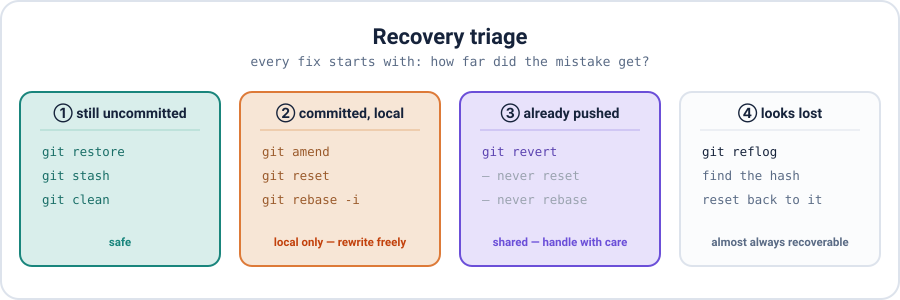
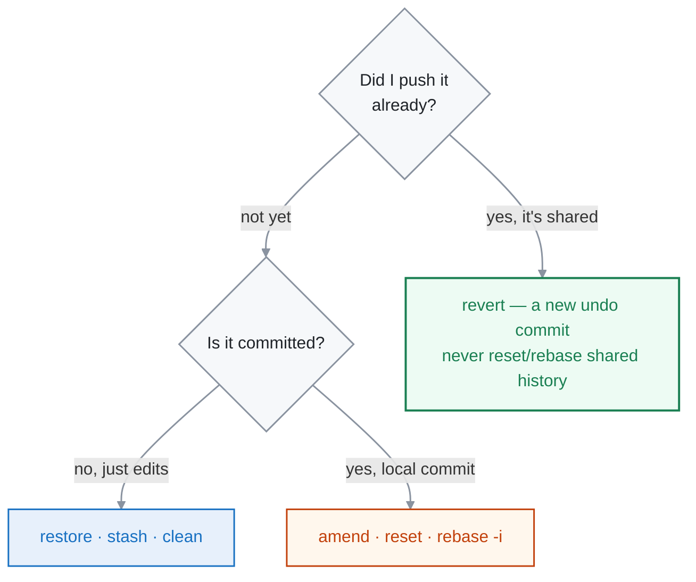

<div align="center">

# ⛑ Recovery Guide — I Screwed Up, Now What?

**Appendix** · ✅ Done

</div>

> The page I reach for when something goes wrong at the terminal. Find the disaster, run the fix. Every answer traces back to one question: **has it been shared yet?** — because that decides whether I can rewrite it or have to undo it with a new commit.

### 📌 Find your disaster

| Symptom | Jump to | Tag |
|---|---|:-:|
| Changed a file, want the saved version back | [Discard uncommitted changes](#discard-uncommitted-changes) | 🟢 |
| Need to switch branch mid-edit | [Stash work in progress](#stash-work-in-progress) | 🟢 |
| Junk/untracked files cluttering the repo | [Clean untracked files](#clean-untracked-files) | 🟡 |
| Bad commit message | [Fix the last message](#fix-the-last-commit-message) | 🟢 |
| Forgot to include a file in the last commit | [Add to the last commit](#add-a-forgotten-file) | 🟢 |
| Committed too early / want it undone | [Undo a local commit](#undo-a-local-commit) | 🟢 |
| Committed on the wrong branch | [Move a commit to another branch](#commit-on-the-wrong-branch) | 🟡 |
| `reset --hard` ate my work | [Recover with reflog](#recover-with-reflog) | 🟡 |
| Already **pushed** a bad commit | [Revert a shared commit](#revert-a-shared-commit) | 🔴 |
| Committed a password / secret | [Remove a committed secret](#remove-a-committed-secret) | 🔴 |

🟢 safe · 🟡 careful, read the note · 🔴 touches shared history — handle with care

<p align="center"></p>

---

## The one rule

Everything below is just this picture applied to a specific mess:



---

## Still uncommitted

### Discard uncommitted changes

I edited a file and want it back exactly as the last commit had it:

```bash
git restore app.txt       # one file
git restore .             # everything in the working dir
# file is back to its committed state
```

> [!NOTE]
> `git restore` replaced the old `git checkout -- <file>` for this job. Both still work, but `restore` is the clearer, newer name. It only touches my **working files** — committed history is untouched.

### Stash work in progress

Half-done work, but I need a clean tree to switch branches or pull:

```bash
git stash                 # shelve my changes, tree goes clean
# Saved working directory and index state WIP on main: 07dd0b8 Add app
git stash list
# stash@{0}: WIP on main: 07dd0b8 Add app

# ...do the other thing, then bring it back:
git stash pop             # re-apply and remove from the stash
```

### Clean untracked files

New files Git isn't tracking yet, cluttering `git status`. **Always dry-run first:**

```bash
git clean -n              # -n = dry run, just shows what WOULD go
# Would remove junk.tmp
git clean -f              # -f = actually delete them
```

> [!WARNING]
> `git clean -f` permanently deletes untracked files — they were never in Git, so there's **no reflog, no recovery.** The `-n` dry run exists precisely so I never run `-f` blind.

---

## Committed, but not pushed

### Fix the last commit message

```bash
git commit --amend -m "The message I meant to write"
```

### Add a forgotten file

Stage what I missed, then fold it into the last commit without a new one:

```bash
git add forgotten.txt
git commit --amend --no-edit     # keep the existing message
```

### Undo a local commit

Committed too early. Keep the work, just un-commit it:

```bash
git reset --soft HEAD~1    # un-commit, changes stay STAGED
git reset HEAD~1           # un-commit, changes stay in files (unstaged)
```

Want the commit *and* its changes gone for good (local only)?

```bash
git reset --hard HEAD~1    # ⚠ discards the changes too
```

(The three reaches are the diagram in [module 10](../10-rewriting-history/README.md).)

### Commit on the wrong branch

I committed on `main` but it belonged on a feature branch. Copy it over, then rewind `main`:

```bash
git branch feature-x        # mark this commit as a branch
git reset --hard HEAD~1     # move main back (the commit is safe on feature-x)
git switch feature-x        # my work is here
```

> [!NOTE]
> This is safe because `git branch feature-x` saves the commit's hash *before* I move `main`. Nothing is deleted — I'm just relabelling where each branch points. Only do it while the commit is still local.

---

## When it looks lost

### Recover with reflog

`reset --hard` rewound past commits I actually wanted. They're not gone — the reflog remembers every position `HEAD` has held:

```bash
git reflog
# 571fbea HEAD@{0}: reset: moving to HEAD~1
# 0f252ec HEAD@{1}: commit: the work I thought I lost
git reset --hard 0f252ec    # jump back to it
```

> [!TIP]
> This also rescues a branch I deleted by mistake, a botched rebase, or a bad merge. **Reflog first, panic never.** Entries stick around for ~90 days by default, so there's plenty of time.

---

## Already pushed / shared

### Revert a shared commit

The commit is on GitHub and teammates may have it. **I do not reset or rebase it** — that rewrites shared history and collides with everyone. Instead I add a new commit that undoes it:

```bash
git revert <commit>        # creates "Revert ..." — cancels the change
git push                   # safe: history stays intact, just extended
```

### Remove a committed secret

I committed an API key or password. Two parts, and the order matters:

1. **Rotate the secret immediately.** Once it's been pushed, assume it's compromised — change the key at its source. Scrubbing Git history does *not* un-leak it.
2. **Stop tracking it**, then ignore it going forward:

```bash
git rm --cached secrets.env
echo "secrets.env" >> .gitignore
git commit -m "Stop tracking secrets.env"
```

> [!WARNING]
> `rm --cached` + a new commit stops *future* exposure, but the secret is **still in the old commits**. Purging it from all history needs a history rewrite (`git filter-repo` or the BFG) and a force-push — which breaks everyone's clone. That's why **rotating the key is the real fix**; history cleanup is secondary.

---

## 🧪 Try it

> Create a repo, make a commit, then stage and commit a fake `secret.txt`. Practice the recovery: `git rm --cached secret.txt`, add it to `.gitignore`, and commit. Then separately, make a commit, `reset --hard` past it, and bring it back with `reflog`.

<details>
<summary>Show the answer</summary>

```bash
git init -b main
echo "key=123" > secret.txt && git add . && git commit -m "oops secret"
git rm --cached secret.txt
echo "secret.txt" >> .gitignore
git commit -m "Stop tracking secret.txt"

echo "real work" > w.txt && git add . && git commit -m "work"
LOST=$(git rev-parse HEAD)
git reset --hard HEAD~1       # "lost" it
git reflog                    # find it
git reset --hard $LOST        # back again
```

</details>

## 🤔 What confused me

> That there isn't one universal "undo" in Git. I kept looking for a `git undo`, but the right fix depends entirely on *how far the mistake travelled* — a working-file edit, a local commit, or something I've already pushed each have a different safe answer. Once I started every recovery by asking "did I push it yet?", the whole mess sorted itself into the four lanes on the map above.

---

**One-line recap:** start every recovery with **"has it been shared?"** Uncommitted → `restore`/`stash`/`clean`. Local commit → `amend`/`reset`/`rebase`. Pushed → `revert`, never reset. Lost → `reflog`. Secrets → rotate first, then stop tracking.

---

[⬅ 10 · Rewriting History](../10-rewriting-history/README.md) · [🏠 Index](../README.md)
